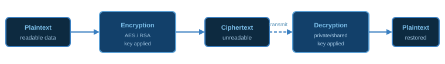
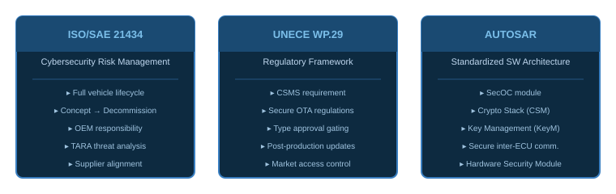

## Communication and Software Security

This document covers the cybersecurity threat landscape from external entry points through the vehicle's in-car network — addressing protection mechanisms, secure design principles, communication protocols, and industry best practices.

### Keywords and Concepts in Communication Security

- **Integrity**: ensures messages are unaltered in transit
- **Confidentiality**: protects privacy and prevents unauthorized access to data
- **Authenticity**: verifies the legitimacy of data sources and senders

### Attack Scenarios

Potential entry points:
- **Keys and smartphones**: passive keyless entry, remote start features
- **Infotainment and personalization**: user data, app integration, media ports
- **Vehicle networks**: CAN bus, Bluetooth, USB ports, OBD-II diagnostic port

### Addressing Attacks

Three strategies — Encryption, Authenticity, and Intrusion Detection — work together to prevent impersonation and ensure data comes from trusted sources:

- **Secure communication protocols**
  - Encryption: first line of defense; prevents altering data in transit
  - Firewall: controls traffic entering and leaving the internal vehicle network
  - Network segmentation: isolates critical vehicle functions from non-critical systems, containing potential intrusions

- **Authenticity**: prevents both external intruders and insider threats; defines roles and privileges — must be combined with encryption

- **Intrusion detection**: monitors systems, provides alerts, and triggers countermeasures

#### Secure OTA Updates
- Uses 4G/5G cellular networks for rapid, remote software deployment
- 5G provides improved network access security and lower attack surface compared to earlier generations

#### Secure Boot
See [Secure Boot deep-dive](../md/3.3.1-Embedded-Fundamentals-SecureBoot.md) for full details. Overview:
- Verifies software integrity via cryptographic signatures at startup
- Prevents unauthorized or modified code from executing on device startup

---

### Basic About Encryption

**Algorithm comparison**:

| | Symmetric | Asymmetric |
|---|---|---|
| **What it is** | Same key shared by sender and receiver | Public key encrypts; only private key holder decrypts |
| **Advantage** | Fast; low latency; suitable for large data volumes | No shared secret needed; strong key confidentiality |
| **Use cases** | Real-time in-vehicle data streams | Secure key exchange, digital signatures |
| **Examples** | AES — secures CAN, FlexRay traffic | RSA — secure key exchange at session setup |

---

### Software Security Techniques

Security is embedded at every phase of development — OEMs bear primary responsibility for the overall security posture:

- **Security by design**: threat assessment and risk analysis conducted in early development phases
- **Requirements phase**: identify both functional and non-functional security requirements
- **Design phase**: apply model-based design to enforce security architecture decisions
- **Specification phase**: map software security layers and communication techniques to components
- **Implementation phase**:
  - Static code analysis: detects buffer overflow, SQL injection, cross-site scripting
  - Peer code review: human validation layer against logic and security flaws
  - Secure coding standards: enforce type safety, avoid insecure functions
  - Input validation: reject malformed data at all entry points — UI, network, external devices
  - Threat modeling: identify attack vectors early; prioritize countermeasures by risk
  - Dependency management: audit open-source and third-party components for known CVEs

**Secure hardware design** supports software security from the ground up:
- **Secure boot mechanisms**: verify cryptographic signatures before any code executes
- **Cryptographic hardware accelerators**: offload AES, RSA, hashing from main CPU — faster and tamper-resistant
- **Trusted Execution Environments (TEE)**: isolated execution zones (e.g., ARM TrustZone) that remain protected even if the main OS is compromised
- **Physically Unclonable Functions (PUF)**: hardware-generated keys unique to each device; nearly impossible to duplicate

**Secure-by-design principles**:
- **Secure communication protocols**: encryption and authentication at every data path in the vehicle
- **Principle of least privilege**: users and subsystems access only what they need to perform their function
- **Defense in depth**: multiple independent security layers — if one layer fails, others still protect

---

### Automotive Secure Communication

Secure communication protocols define formal rules for transmitting data with **integrity**, **confidentiality**, and **authenticity** — preventing cyber attacks on both internal and external vehicle networks.

Key protocols used in automotive systems:

| Protocol | What it is | Security feature |
|---|---|---|
| **CAN** | Reliable in-vehicle bus standard | Baseline protocol; requires additions for security |
| **CAN FD** | CAN extension for larger payloads and faster rates | Handles high-volume modern data traffic |
| **CANCrypt** | CAN with encryption/authentication layer | Protects against unauthorized access and message replay |
| **SecOC** | AUTOSAR secure onboard communication | Message authentication (CMAC/HMAC) for integrity and anti-spoofing |
| **Automotive Ethernet** | High-bandwidth adapted Ethernet standard | Supports camera feeds, infotainment, ADAS at Gbit/s rates |

---

### Automotive Data Management

Modern vehicles generate continuous sensor, telemetry, and user data — used for performance optimization, predictive maintenance, and driver personalization. The automotive data management market is projected to grow from $2.19B (2022) to $14.29B (2032).

Key data protection practices:

- **Encryption**: data unreadable without decryption key — applied both in transit and at rest
- **Secure access controls**: authentication and authorization protocols restrict access to authorized users and systems only
- **Data anonymization**: strips personally identifiable information (PII) before sharing with third parties; supports GDPR compliance

#### Security Sub-System

Hardware security subsystems provide the cryptographic foundation for all higher-level protections:

- **Secure memory**: protected RAM, Flash, ROM — isolated from the main application core
- **Control logic and state machine**: governs security policy transitions and enforcement
- **Crypto hardware accelerator**: performs AES, RSA, hashing in dedicated silicon — faster and more tamper-resistant than software implementations
- Based on **Hardware Security Module (HSM)** / secure hardware extension

Reference: [Cryptography in Automotive — GetToByte](https://gettobyte.com/how-cryptography-in-automotive-is-implemented/)

---

### Secure V2X Communication

- **What it is**: enhances safety and traffic flow by sharing information — dynamic information exchange between vehicles and their environment, encompassing other vehicles, road infrastructure, and various transportation entities
- **What risks**: relies heavily on wireless communication; requires encryption and authentication to prevent attacks such as eavesdropping, spoofing, and man-in-the-middle interception

V2X security measures:
- **Data encryption**: protects transmitted location, speed, and identity data from interception
- **Authentication and integrity**: digital signatures ensure data is from legitimate sources and unaltered in transit
- **Data anonymization**: pseudonym changes protect driver identity while enabling traffic analytics
- **Strictly necessary data sharing**: minimum data exchange to reduce attack surface (principle of least privilege)

V2X connection types:
- **Bluetooth**: short-range, in-car device pairing
- **Mobile networks (4G/5G)**: long-range real-time updates and emergency notifications
- **Dedicated WLAN (DSRC)**: low-latency V2V and V2I safety applications — collision avoidance
- **Dedicated cellular (C-V2X, 5G)**: autonomous driving, advanced traffic management

---

### Best Practices for Automotive Systems

#### Work Culture
- Tight coordination across software, hardware, and network security teams
- Iterative development with continuous security testing throughout the lifecycle
- Continuous post-production security updates and threat mitigation
- Detailed incident response plans for cybersecurity events

#### Applying Standards

- **ISO/SAE 21434**: cybersecurity risk management framework for road vehicles — covers the full lifecycle from concept through decommissioning; mandates TARA (threat analysis and risk assessment)
- **UNECE WP.29**: regulatory framework requiring OEM-level Cybersecurity Management Systems (CSMS) and secure software update mechanisms; gates market access
- **AUTOSAR**: standardized software architecture ensuring secure, authenticated communication between vehicle components via SecOC, Crypto Stack, and Key Management modules

#### Architecture Design
- **Layered security (defense in depth)**: each layer addresses different vulnerability classes — a breach of one layer does not compromise the whole system
- **Secure communication protocols**: see [Automotive Secure Communication](#automotive-secure-communication)

#### Risk Management Process

1. **Identify**: catalog assets, threats, and attack surfaces
2. **Assess**: analyze impact and likelihood — FMECA utilized for structured analysis
3. **Quantify and prioritize**: build a Risk Breakdown Structure (RBS); select treatment strategies to mitigate identified risks
4. **Monitor and report**: ongoing tracking of residual risks and emerging threats

References: [NIST Compliance Guide](https://hyperproof.io/resource/a-complete-guide-to-nist-compliance/) · [NIST CSF 2.0](https://hyperproof.io/nist-cybersecurity-framework/)
