# Introduction

These notes are a condensed second source of truth for ISO 26262 self-study, scoped to what's relevant
for Level 1 functional-safety certification - not a full restatement of the standard. The first source of
truth is always the official ISO 26262 parts themselves; every claim below is cross-referenced to its exact
clause so it can be checked against the original text, and anything outside Level 1 scope is deliberately
left out rather than summarized.

# ISO 26262-1 - Terminology

## 1-3 Core Vocabulary: Item, Function, Functional Safety, ASIL, Confirmation Measures (Clause 3)

* **Vehicle function** (Clause 3.178) - the *customer-observable* behaviour of the vehicle, intended by the
  implementation of one or more items. This is what "feature" means in everyday industry usage.
  Example (Clause 3.178): "automatic cruise control" is a vehicle function, regardless of which ECUs or
  sensor technologies (radar, lidar, camera) end up implementing it.
* **Item** (Clause 3.84) - the system, or combination of systems, to which ISO 26262 is applied, that
  *implements* a function or part of a function at the vehicle level. This is where the hardware,
  electronics and software requirements actually live - i.e. "function" in the everyday sense (as opposed
  to "feature") corresponds to an item's **intended functionality** (Clause 3.83): the behaviour specified
  for an item, *excluding* its safety mechanisms.
* **Functional safety** (Clause 3.67) - the absence of unreasonable risk due to hazards caused by
  *malfunctioning behaviour* of E/E systems. Two consequences worth internalizing early:
  - functional safety is about risk reduction from malfunctions, not about eliminating all failures
    outright; and
  - a failure only falls inside ISO 26262's scope if its malfunctioning behaviour could plausibly hazard a
    person - see Hazard Analysis and Risk Assessment (ISO 26262-3:2018, Clause 6) for how "could hazard a
    person" gets classified and turned into an ASIL.
* **ASIL - Automotive Safety Integrity Level** (Clause 3) - one of four risk-classification levels
  (**A**-**D**) assigned to a hazardous event, expressing the necessary ISO 26262 requirements and safety
  measures needed to reduce residual risk to an acceptable level; **D** is the most stringent, **A** the
  least. The determination method (combining Severity, Exposure and
  Controllability classes into an ASIL via Table 4) lives in ISO 26262-3:2018, Clause 6.4.3, not in Part 1 -
  Part 1 only defines the term itself. A hazardous event that doesn't warrant a dedicated ASIL is classified
  **QM** (Quality Management): no ISO 26262-specific safety measures are required, and the organisation's
  ordinary quality-management process is considered sufficient.
* **Confirmation measure** (Clause 3) - the collective term for three independent-substantiation
  activities: **confirmation review**, **functional safety audit**, and **functional safety assessment**. Part 1 only names the term; the actual process requirements,
  independence-level scale (I0-I3), and the work-product/ASIL table are normatively defined in
  ISO 26262-2:2018, Clause 6.4.9-6.4.12 - see "Confirmation measures" under ISO 26262-2 below for the full
  breakdown (Table 1).

## 1-3 Fault Terminology (Clause 3)

### Fault vs Failure

* **Fault** (Clause 3.54) - an *abnormal condition* that can cause an element/item to fail. Permanent,
  intermittent and transient faults (incl. soft errors) all count.
* **Failure** (Clause 3.50) - the *termination of intended behaviour* of an element/item due to a fault
  manifesting. Can be permanent or transient.
* In short: a fault is the underlying defect; a failure is what happens when that defect actually stops
  the intended behaviour.

### Random Hardware Failure

Clause 3.118 - a failure that can occur *unpredictably* during the lifetime of a hardware element and
follows a probability distribution (so its rate can be predicted with reasonable accuracy, Note 1). The
corresponding **random hardware fault** (Clause 3.119) is simply a hardware fault with a probabilistic
distribution.

### Cascading Failure

Clause 3.17 - a failure of one element, resulting from a root cause inside or outside that element, that
then *causes* a failure of another element (same or different item). Cascading failures are a type of
**dependent failure** (Clause 3.29, Note 2) and can be a root cause of a **common cause failure**
(Clause 3.17, Note 1).

### Systematic Failure

* **Systematic failure** (Clause 3.164) - a failure related in a *deterministic* way to a certain cause,
  that can only be eliminated by changing the design, the manufacturing process, operational procedures,
  documentation, or other relevant factors.
* **Systematic fault** (Clause 3.165) - the fault whose failure manifests deterministically and can only
  be *prevented* by process or design measures (not by adding more hardware margin, since it isn't random).

### Common Cause Failure vs Common Mode Failure vs Dependent Failure

* **Dependent failures** (Clause 3.29) - failures that are *not statistically independent*, i.e. the
  probability of them occurring together isn't the product of their individual probabilities. This is the
  umbrella term; it includes both common cause failures and cascading failures (Note 2).
* **Common cause failure (CCF)** (Clause 3.18) - failure of *two or more* elements resulting directly from
  a *single* specific event or root cause, internal or external to all of them. CCFs are dependent failures
  that are *not* cascading failures (Note 1).
* **Common mode failure (CMF)** (Clause 3.19) - the special case of a CCF where the multiple elements fail
  *in the same manner* (not necessarily identically - how close counts as "the same manner" is contextual,
  Note 1). Example: two temperature sensors that are cross-checked both drift in the same direction by less
  than the 5 °C threshold, so the mismatch is never detected (Clause 3.19, Example 1); or a CPU lockstep
  pair where both cores fail exactly the same way so the cycle-by-cycle comparison never flags it (Example 2).
* Whether a given dependent failure counts as "cascading" or "common cause" can depend on the hierarchical
  structure and temporal behaviour of the elements involved (Clause 3.29, Notes 3-4).

### Dual-Point Fault / Dual-Point Failure

* **Dual-point failure** (Clause 3.38) - a failure resulting from the combination of *two independent*
  hardware faults that *directly* violates a safety goal. It's a multiple-point failure of order 2 (Note 1).
  The addressed case is typically: one fault hits the safety-related element, a second independent fault
  hits the safety mechanism meant to catch the first one (Note 2).
* **Dual-point fault** (Clause 3.39) - an individual fault that, combined with another independent fault,
  *leads to* a dual-point failure. It can only be identified retroactively, after the dual-point failure
  itself has been identified (e.g. via fault-tree cut-set analysis, Note 1).

### Residual Fault

Clause 3.125 - the *portion* of a random hardware fault that, by itself, violates a safety goal and is
*not* controlled by any safety mechanism. This presumes the safety mechanism only covers part of the
fault space (Note 1): e.g. if a safety-relevant fault set has 60% diagnostic coverage, the uncovered 40%
are residual faults (Example).

* So: the safety mechanism exists, but the coverage gap it leaves behind *is* the residual fault.

### Single-Point Fault / Single-Point Failure

* **Single-point fault** (Clause 3.156) - a hardware fault in an element that *directly* violates a safety
  goal, where **no** fault in that element is covered by *any* safety mechanism.
* **Single-point failure** (Clause 3.155) - the failure that results from a single-point fault.
* Key distinction from residual fault: if even one safety mechanism exists for that hardware element (e.g. a
  watchdog on a microcontroller), none of that element's faults are single-point faults anymore (Note 2) -
  at best they become residual faults (partially covered) or are fully covered.

### Multiple-Point Fault

* **Multiple-point failure** (Clause 3.96) - a failure resulting from the combination of *several*
  independent hardware faults that directly violates a safety goal (dual-point failure is the order-2
  special case).
* **Multiple-point fault** (Clause 3.97) - an individual fault that, combined with other independent
  faults, *if undetected and not perceived*, could lead to a multiple-point failure. Like the dual-point
  fault, it's only recognizable after the fact via cut-set analysis (Note 1).

### Time Intervals (FTTI / FHTI / EOTI)

* **Fault tolerant time interval (FTTI)** (Clause 3.61) - the *minimum* time-span from a fault occurring in
  the item to the possible occurrence of a hazardous event, if safety mechanisms are **not** activated.
  This is the deadline the safety mechanism has to beat.
* **Fault handling time interval (FHTI)** (Clause 3.56) - fault detection time interval (FDTI) + fault
  reaction time interval (FRTI), i.e. how long the safety mechanism itself takes to detect the fault and
  react to it.
* **Emergency operation time interval (EOTI)** (Clause 3.44) - the time-span during which emergency
  operation (a reduced-function holding state used when a safe state can't be reached directly or in time,
  Clause 3.43) is maintained before finally transitioning to the safe state.
* A fault is considered "timely covered" (Clause 3.61, Note 4) if one of three things happens within the
  FTTI:
  - the item stays in a safe state;
  - the item transitions directly to a safe state; or
  - the item transitions to emergency operation - for this **third scenario**, the safety mechanism must
    both detect and react to the fault *and* hold emergency operation long enough to still reach the safe
    state before the FTTI deadline, i.e. **FHTI + EOTI ≤ FTTI**.

## 1-3 Safety Goal, Mechanism and Concept Vocabulary (Clause 3)

* **Hazard** (Clause 3.75) - a potential source of harm caused by the item's malfunctioning behaviour.
* **Hazardous event** (Clause 3.77) - the combination of a hazard and an **operational situation** (Clause
  3.104, a scenario that can occur during the vehicle's life, e.g. driving at high speed, parking on a
  slope, maintenance).
* **Hazard analysis and risk assessment (HARA)** (Clause 3.76) - the method used to identify/categorize
  hazardous events and derive safety goals and ASILs for them; see Hazard Analysis and Risk Assessment
  (ISO 26262-3:2018, Clause 6) below for the full process.
* **Severity / Exposure / Controllability /ASIL** (Clauses 3.154/3.48/3.25) - the three parameters (S/E/C)
  combined/summed into an ASIL during HARA: 
  * severity estimates the extent of harm; 
  * exposure is the probability of
  being in the hazardous operational situation;
  * controllability is the ability of those involved (driver, passengers, bystanders) to avoid the harm through timely reaction, possibly aided by external measures.
  * ASIL determination is a lookup table (ISO 26262-3:2018 Table 4), not a formula - the ASIL (or QM, i.e.
    no safety requirement) for each S/E/C combination is:

    | Severity | Exposure | C1 | C2 | C3 |
    |---|---|---|---|---|
    | S1 | E1 | QM | QM | QM |
    | S1 | E2 | QM | QM | QM |
    | S1 | E3 | QM | QM | A |
    | S1 | E4 | QM | A | B |
    | S2 | E1 | QM | QM | QM |
    | S2 | E2 | QM | QM | A |
    | S2 | E3 | QM | A | B |
    | S2 | E4 | A | B | C |
    | S3 | E1 | QM | QM | A |
    | S3 | E2 | QM | A | B |
    | S3 | E3 | A | B | C |
    | S3 | E4 | B | C | D |

    Mnemonic: numbering the classes S1..S3 = 1..3, E1..E4 = 1..4, C1..C3 = 1..3 and summing the three
    reproduces this table exactly - total <= 6 => QM, 7 => A, 8 => B, 9 => C, 10 => D (only reachable via
    S3 + E4 + C3).
* **Safety goal** (Clause 3.139) - the top-level safety requirement resulting from HARA at the vehicle
  level; one safety goal can address several hazards and vice versa (Note 1).
* **Functional safety concept** (Clause 3.68) - the specification of functional safety requirements and
  their allocation to elements, needed to achieve the safety goals.
* **Functional safety requirement (FSR)** (Clause 3.69) - an implementation-independent safety requirement
  or safety measure derived from a safety goal, carrying an ASIL.
* **Technical safety concept / technical safety requirement (TSR)** (Clauses 3.167/3.168) - the
  system-level refinement of the above: TSRs are the implementation-oriented requirements derived from
  FSRs, and the technical safety concept is TSRs plus their allocation to system elements with rationale.
* **Safety measure** (Clause 3.141) - any activity or technical solution that avoids/controls systematic
  failures or detects/controls random hardware failures (or mitigates their effects). **Safety mechanism**
  (Clause 3.142) is the narrower case: a technical solution (E/E or other technology) that detects and
  mitigates/tolerates faults, or controls/avoids failures, to maintain intended functionality or
  achieve/maintain a safe state.
* **Safe state** (Clause 3.131) - an operating mode that, in the case of a failure, carries no unreasonable
  risk. **Operating mode** (Clause 3.102) itself is just any functional-state condition arising from using
  the item - examples: off, active, passive, degraded operation, emergency operation, safe state.
* **Warning and degradation strategy** (Clause 3.183) - the specification of how the driver is warned of
  reduced functionality and how that reduced functionality is delivered on the way to a safe state; ties
  together the safe-state definition, degradation, and (if applicable) emergency operation and its
  tolerance time interval.
* **Safety-related element / function** (Clauses 3.144/3.145) - an element or function that has the
  *potential* to contribute to violating **or** achieving a safety goal - note this cuts both ways: an
  element counts as safety-related whether it threatens the goal or protects it (Note 1: fail-safe
  elements are safety-related if they can contribute to at least one safety goal).

## 1-3 Architecture, Independence and Reuse Vocabulary (Clause 3)

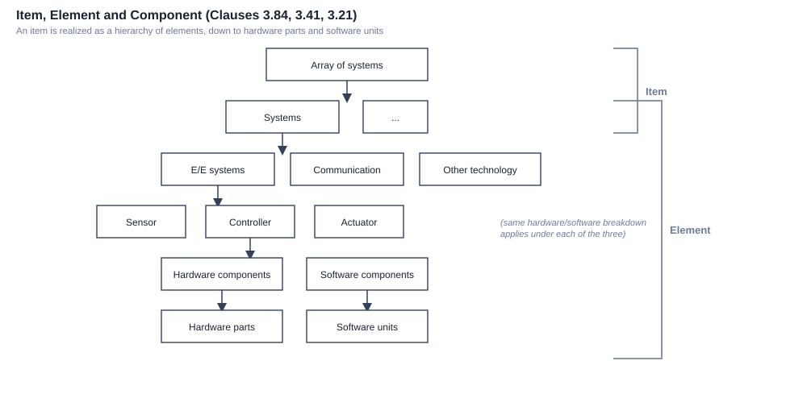

* **Architecture** (Clause 3.1) - the structural representation of an item or element that identifies
  building blocks, boundaries and interfaces, and allocates requirements to those blocks.
* **Element** (Clause 3.41) - the umbrella term beneath item: a system, component (hardware or software),
  hardware part, or software unit. An item is realized as one or more elements, decomposing down through
  systems, E/E systems, sensor/controller/actuator, hardware/software components, to hardware parts and
  software units.
* **System** (Clause 3.163) - a set of components or subsystems relating at least a sensor, a controller
  and an actuator to one another.
* **Independence** (Clause 3.78) - the absence of dependent failures between elements that could violate a
  safety requirement, **or** organizational separation of the people performing an action - this second
  sense is what the confirmation-measure independence levels (I0-I3, see ISO 26262-2 below) are built on.
* **Freedom from interference** (Clause 3.65) - the narrower, purely-technical case of independence:
  absence of *cascading* failures between elements.
* **Independent failures** (Clause 3.79) - failures whose joint probability is just the product of their
  individual probabilities - the mirror image of dependent failures.
* **Diversity** (Clause 3.37) - different solutions satisfying the same requirement, aimed at achieving
  independence; doesn't guarantee it, but helps against some common cause failures. **Redundancy** (Clause
  3.122) - having more than the minimum means necessary to perform a function or represent information;
  diversity is one way to realize redundancy (Note 3), but redundancy can also be homogeneous.
* **ASIL decomposition** (Clause 3.3) - apportioning a redundant safety requirement across sufficiently
  independent elements to reduce the ASIL each element needs to meet, while the combined requirement still
  serves the same safety goal; doesn't apply to random-hardware-failure requirements (Note 2), and
  confirmation measures stay pinned to the safety goal's original ASIL regardless (Note 3).
* **Safety Element out of Context (SEooC)** (Clause 3.138) - a safety-related element developed without a
  specific item in mind, using assumed requirements that get validated once integrated into a real item
  (e.g. a generic wiper system meant for multiple OEM platforms).
* **Candidate / proven-in-use argument** (Clauses 3.16/3.115) - a candidate is an item/element whose
  definition and use conditions are identical (or very close) to something already released and in
  service; a proven-in-use argument is the field-data-based evidence that the candidate's failure
  probability meets its ASIL - see Proven-in-Use Argument (ISO 26262-8:2018, Clause 14) below for the
  quantitative targets.

## 1-3 Diagnostic, Verification and Process Vocabulary (Clause 3)

* **Diagnostic coverage (DC)** (Clause 3.33) - the percentage of a hardware element's (or one of its
  failure modes') failure rate that's detected or controlled by an implemented safety mechanism; see "What
  Diagnostic Coverage (DC) Is" under ISO 26262-5 below for how this is actually banded and used.
* **Safe fault** (Clause 3.130) - a fault whose occurrence won't meaningfully raise the probability of
  violating a safety goal; single-point faults, residual faults and dual-point faults can never be safe
  faults (Note 2), but multiple-point faults of order higher than 2 can be treated as safe unless the
  safety concept says otherwise (Note 3).
* **Detected fault** (Clause 3.31) - a fault whose presence a safety mechanism catches within a prescribed
  time. **Perceived fault** (Clause 3.108) - a fault noticed *indirectly*, through the vehicle behaving
  differently, rather than via a safety mechanism. **Latent fault** (Clause 3.85) - a multiple-point fault
  caught by *neither* a safety mechanism *nor* the driver within the multiple-point fault detection time
  interval - the dangerous "silently waiting for a second fault" case.
* **Dedicated measure** (Clause 3.27) - a measure used to justify the failure rate claimed for a component
  in a safety-goal-violation evaluation, e.g. hardware over-design, incoming-material sample testing,
  burn-in testing, or a dedicated control plan.
* **Verification** (Clause 3.180) - determining whether an examined object meets its specified
  requirements, via review, walk-through, inspection, testing, simulation, prototyping or analysis.
  **Review** (Clause 3.127) is the generic examination of a work product against its intended goal;
  **walk-through** (Clause 3.182) and **inspection** (Clause 3.82) are increasingly formal review types -
  a walk-through has the author narrate the work product to reviewers, while an inspection follows a
  defined procedure/checklist/moderator.
* **Work product** (Clause 3.185) - the documentation resulting from one or more ISO 26262 requirements;
  can be a single document or a set of documents that together carry the complete information.
* **Development Interface Agreement (DIA)** (Clause 3.32) - the customer-supplier agreement covering
  responsibilities, evidence and work products exchanged during *development*; its production-phase
  counterpart is the **supply agreement** (Clause 3.162). See Interfaces within Distributed Developments
  (ISO 26262-8:2018, Clause 5) below for the full content requirements.
* **Safety case** (Clause 3.136) - the compiled argument, backed by work-product evidence, that functional
  safety has been achieved for an item or element; can be extended to cover safety issues beyond
  ISO 26262's own scope.
* **Safety anomaly** (Clause 3.134) - any condition that deviates from expectations and could lead to
  harm - the trigger for the anomaly-management process under ISO 26262-2 (Clause 5.4.3) below.

# ISO 26262-2 - Functional Safety Management

Part 2 is organized as three clauses (ref. ISO 26262-2:2018 Table of Contents):

* **Clause 5** Overall safety management (project-independent)
* **Clause 6** Project-dependent safety management
* **Clause 7** Safety management regarding production, operation, service and decommissioning

These notes label them "2-5", "2-6", "2-7" (Part-Clause) to keep them easy to cross-reference against
the rest of the safety lifecycle:

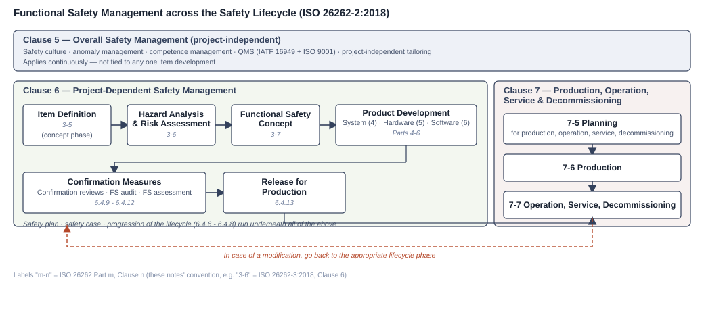

Clause 6 (project-dependent) is the largest and busiest of the three - it's where a project's safety
manager actually lives day to day - so most of this section is built around it.

## 2-5 Overall Safety Management (Clause 5) - Project-Independent

**Objective**: put the organization-wide foundations in place *before* any specific project starts, so every
project can build on them rather than reinvent them (Clause 5.1).

One way to visualize the split this section and the next one are built around: a company-wide,
project-independent FSM (this section) that every business unit and item development draws on, versus a
project-specific FSM instance stood up for each item development (Clause 6, below):

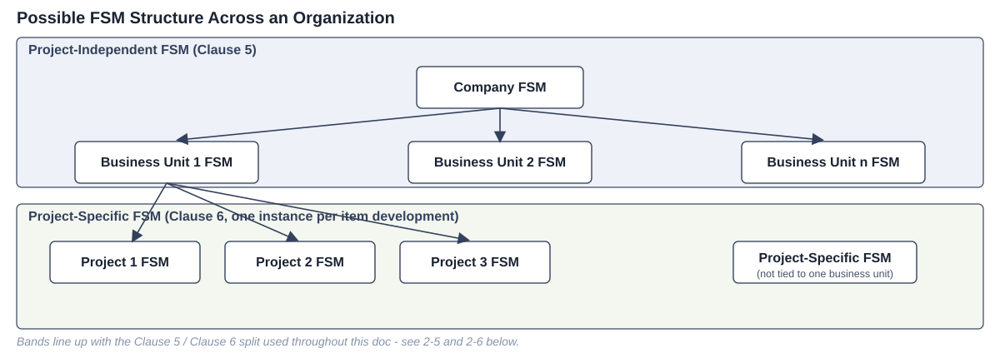

Zooming into any single "Project N FSM" box from that diagram gives the roles who actually run it - the
project manager and safety manager named in Clause 6.4.2, with the safety team/engineers underneath them
being an illustrative (not normatively named) breakdown:

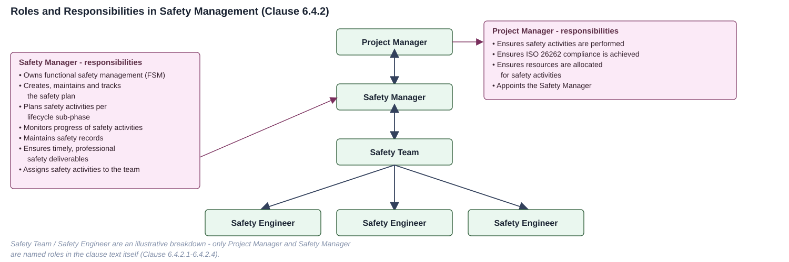

**Safety culture** (Clause 5.4.2.1-5.4.2.7) - the organization:
  - creates, fosters and sustains a safety culture (indicators listed in Annex B, e.g. process
    accountability, a reward system that doesn't punish raising problems, encouraged self-disclosure)
    (5.4.2.1);
  - maintains organization-specific rules/processes to comply with ISO 26262 (5.4.2.2);
  - keeps communication channels open between functional safety and adjacent disciplines - cybersecurity,
    mechanical safety, quality (5.4.2.3, with cybersecurity interaction guidance in Annex E);
  - documents/manages activities per ISO 26262-8:2018, Clause 10 (5.4.2.4);
  - provides the needed resources (5.4.2.5);
  - runs a continuous-improvement process fed by field/lifecycle experience (5.4.2.6); and
  - gives the people doing safety work enough authority to actually do it (5.4.2.7).

**Management of safety anomalies** (Clause 5.4.3):
  - anomalies get explicitly communicated to whoever is responsible for functional safety (5.4.3.1);
  - they run through a resolution process (analysed, evaluated, resolved, closed - 5.4.3.2);
  - they're only considered "managed to closure" if either an adequate safety measure resolves them with
    verified effectiveness, or a documented, reviewed rationale shows they don't constitute unreasonable
    risk (5.4.3.3-5.4.3.4); and
  - anomalies that don't reach closure escalate to the project manager (5.4.3.5).

**Competence management** (Clause 5.4.4) - people executing the safety lifecycle need sufficient skills,
competence and qualification for their responsibilities (5.4.4.1), typically via a training programme
covering safety practices, ISO 26262 itself, and org-specific rules (Note 1).

**Quality management system** (Clause 5.4.5) - the organization needs a QMS that supports functional
safety and complies with a recognized quality standard, e.g. **IATF 16949 in conjunction with ISO 9001**
(5.4.5.1).

**Project-independent tailoring** (Clause 5.4.6) - tailoring of the safety lifecycle for use *across*
item developments within the organization (as opposed to tailoring for one specific item, which is
Clause 6.4.5). Limited to six specific moves: combining/splitting sub-phases or activities; moving an
activity to a different or an added phase; iterating phases; running safety activities concurrently
with other phases' activities; or omitting a phase/sub-phase that doesn't apply, with a rationale
(5.4.6.1 a-f).

**Work products** (Clause 5.5):

* Organization-specific rules and processes for functional safety (5.5.1)
* Evidence of competence management (5.5.2)
* Evidence of a quality management system (5.5.3)
* Identified safety anomaly reports, if applicable (5.5.4)

## 2-6 Project-Dependent Safety Management (Clause 6)

**Objective**: get the roles, planning, tailoring and confirmation activities right for *this* specific item
development (Clause 6.1).

**Confirmation measures vs. verification activities** - worth keeping distinct (Clause 6.2):
  * *confirmation measures* (reviews, audit, assessment) judge whether functional safety itself has been
    achieved, with independence requirements attached;
  * *verification activities*, required elsewhere in ISO 26262, instead check that a work product meets
    its project and technical requirements (e.g. w.r.t. use cases and failure modes);
  * a confirmation review and a verification review *may* be combined, provided the combined review still
    meets the required independence level (6.4.10.5).

**Roles and responsibilities** (Clause 6.4.2):
  A project manager is appointed at project initiation (6.4.2.1) with the responsibility:
  - to ensure safety activities happen and ISO 26262 compliance is achieved (6.4.2.2);
  - verifies the organization actually provided the needed resources (6.4.2.3); and
  - ensures a safety manager is appointed (6.4.2.4) - a role the project manager can
    hold themselves (Note 1), and which is split per customer/supplier in a distributed development (Note 3, referencing ISO 26262-8:2018, Clause 5).

**Impact analysis at the item level** (Clause 6.4.3) - performed at the start of the lifecycle to determine whether the item is a *new development*, a *modification of an existing item*, or an *existing item with a modified environment* (6.4.3.1).
  - For a modification, the analysis identifies design modifications, implementation modifications, and environment-related modifications (6.4.3.2); and
  - it then evaluates the functional-safety implications and the safety activities needed as a result (6.4.3.3).

**Reuse of an existing element** (Clause 6.4.4) - triggers a separate impact analysis at the *element level* (Clause 6.4.4 a-d):
  - identify context modifications;
  - evaluate whether the (possibly modified) element still meets the safety requirements it needs to;
  - identify the resulting safety activities; and
  - evaluate whether existing safety documentation is sufficient.

* An existing element can be reused via four routes (Note 3):
  - (a) hardware element evaluation (ISO 26262-8:2018, Clause 13);
  - (b) software component qualification (ISO 26262-8:2018, Clause 12);
  - (c) a proven-in-use argument (ISO 26262-8:2018, Clause 14); or
  - (d) as a **Safety Element out of Context (SEooC)** (ISO 26262-10).

**Tailoring of the safety activities** (Clause 6.4.5):
  - a safety activity may be omitted or performed differently than the reference lifecycle prescribes, but only with a documented rationale (considering the ASILs involved) captured in the safety plan and reviewed at the safety-plan confirmation review or the functional safety assessment (6.4.5.1);
  - tailoring driven by an impact analysis, a proven-in-use argument, a hardware evaluation, a software qualification, or tool confidence each defer to their respective ISO 26262-8 clause (6.4.5.2-6.4.5.6);
  - tailoring for an SEooC requires the element to be developed from assumed-context requirements that get validated once the element is integrated into its real target application (6.4.5.7); and
  - two T&B-only tailoring rules exist for interfacing out-of-scope applications (6.4.5.8, → ISO 26262-8:2018, Clause 15) and integrating non-ISO-26262 systems (6.4.5.9, → Clause 16).

**Planning and coordination - the Safety Plan** (Clause 6.4.6):
  - the safety manager owns planning, coordination, and progress-tracking of the safety activities
    (6.4.6.1-6.4.6.2);
  - responsibilities are clearly assigned and communicated (6.4.6.3); and
  - the safety plan is either referenced in, or included in, the project plan so safety activities stay
    distinguishable (6.4.6.4).

* The safety plan itself must define (6.4.6.5):
  - project-independent activities folded into project-specific management;
  - tailored activities;
  - planning to comply with Parts 3-6;
  - planning of the Part 8 supporting processes (including DIAs for distributed development);
  - integration/verification/validation planning;
  - the schedule of confirmation reviews, functional safety audit and functional safety assessment;
  - dependent-failure and safety-analysis planning (per ISO 26262-9:2018, Clauses 7-8);
  - proven-in-use arguments; and
  - software-tool confidence.
* Each planned activity needs an objective, dependencies, a responsible person, resources, a
  start/end/duration, and its corresponding work product (6.4.6.6). The safety plan is updated
  incrementally, at minimum at the start of each phase (6.4.6.8), and its work products are kept current
  through to release for production (6.4.6.9). In a distributed development, *both* the customer and the
  supplier define their own safety plan for their respective safety activities (6.4.6.10).

**Progression of the safety lifecycle** (Clause 6.4.7):
  - a sub-phase only starts despite missing information from earlier sub-phases if that gap doesn't create
    unreasonable risk; otherwise it's escalated (6.4.7.1); and
  - safety-plan work products must be under configuration management, change management and documentation
    (ISO 26262-8:2018, Clauses 7/8/10) no later than entering "product development at the system level"
    (6.4.7.2).

**Safety case** (Clause 6.4.8):
  - developed per the safety plan to argue functional safety has been achieved (6.4.8.1);
  - progressively compiled from lifecycle work products rather than written at the end (6.4.8.2);
  - in a distributed development, can combine the customer's and suppliers' safety cases, with the DIA
    (ISO 26262-8:2018, Clause 5) defining how the pieces fit together (Note 1); and
  - to support progressive functional safety assessments, it can be released progressively as work
    products are generated - it's not an activity to leave until the end of the safety lifecycle.

**Confirmation measures** (Clause 6.4.9-6.4.12) - three kinds, all aimed at objective, independent
substantiation of achieved functional safety:
  - **confirmation reviews** judge whether key work products give convincing evidence per Table 1
    (6.4.9 a);
  - **functional safety audit** judges whether the required *processes* were actually implemented
    (6.4.9 b); and
  - **functional safety assessment** judges the achieved functional safety of the item, or an element's
    contribution to it (6.4.9 c).

  All three ride on the **level-of-independence** scale, defined identically to the Part 8
  confirmation-measure scale:

  | Level | Meaning |
  |---|---|
  | `—` | No requirement/recommendation either way |
  | **I0** | Should be performed; if performed, by a different person than the work product's author |
  | **I1** | Shall be performed by a different person than the work product's author |
  | **I2** | Shall be performed by someone independent of the *team* (doesn't report to the same direct superior) |
  | **I3** | Shall be performed by someone independent of *management, resources and release authority* from the responsible department |

  **Table 1 - Required confirmation measures and independence levels (ISO 26262-2:2018, Table 1, verified against the rendered PDF page)**

  | Confirmation measure | QM | ASIL A | ASIL B | ASIL C | ASIL D |
  |---|---|---|---|---|---|
  | Impact analysis at the item level (6.5.1) | I3 | I3 | I3 | I3 | I3 |
  | Hazard analysis and risk assessment (ISO 26262-3:2018, Clause 6) | I3 | I3 | I3 | I3 | I3 |
  | Safety plan (6.5.3) | — | I1 | I1 | I2 | I3 |
  | Functional Safety Concept (ISO 26262-3:2018, Clause 7) | — | I1 | I1 | I2 | I3 |
  | Technical Safety Concept (ISO 26262-4:2018, Clause 6) | — | I1 | I1 | I2 | I3 |
  | Integration and test strategy (ISO 26262-4:2018, Clause 7) | — | I0 | I1 | I2 | I2 |
  | Safety validation specification (ISO 26262-4:2018, Clause 8) | — | I0 | I1 | I2 | I2 |
  | Safety analyses & dependent failure analyses (ISO 26262-9:2018, Clauses 8 & 7) | — | I1 | I1 | I2 | I3 |
  | Safety case (6.5.4) | — | I1 | I1 | I2 | I3 |
  | Functional safety audit (6.4.11) | — | — | I0 | I2 | I3 |
  | Functional safety assessment (6.4.12) | — | — | I0 | I2 | I3 |

  Reading the pattern: the two earliest artifacts (impact analysis, HARA) always get the strictest I3
  regardless of ASIL, because a wrong call there mis-scopes everything downstream. Everything else scales
  up with ASIL, and the audit/assessment only kick in from ASIL B upward (6.4.11-6.4.12 apply "for items and
  elements where the highest ASIL of the safety requirements is ASIL (B), C, or D" - Clause 6.4.12.1). One or
  more assistants may support a confirmation review or assessment even without full independence, as long as
  they're at least I1 and their input is appraised for bias (6.4.9.2, 6.4.10.4, 6.4.12.6).
  - **Confirmation reviews** (Clause 6.4.10) - a named reviewer judges the work product's contribution to
    functional safety and reports it (6.4.10.1); all reviews finish before release for production
    (6.4.10.2).
  - **Functional safety audit** (Clause 6.4.11) - judges *process* implementation against:
    * the safety plan's activity definitions, 
    * against org-specific rules, 
    * against any argument offered for why the process objectives are met.
  - **Functional safety assessment** (Clause 6.4.12) - required from ASIL (B)/C/D (6.4.12.1); 
    * should be planned by the start of system-level product development, performed progressively, and finalized before
    release for production (6.4.12.3). 
    * Its scope covers the safety plan and its work products, the required processes, the appropriateness of implemented safety measures, any offered arguments, the safety case,
    and closed safety-anomaly rationales (6.4.12.7). 
    * The report recommends **acceptance**, **conditional
    acceptance** (with named conditions to resolve), or **rejection** (which forces corrective action and a repeat assessment) (6.4.12.9-6.4.12.13).

**Release for production** (Clause 6.4.13):
  - requires the safety case (6.4.13.1) and applicable confirmation-measure reports (6.4.13.2) to exist
    beforehand, and is only approved with sufficient evidence of confidence in achieved functional safety
    (6.4.13.3);
  - the release documentation must record: the release approver's name/signature, the released
    item/element versions, their configuration, references to associated documents, and the release date
    (6.4.13.4); and
  - a software baseline (incl. calibration data) plus a hardware baseline must both exist under
    configuration management at release time (6.4.13.5).

**Work products** (Clause 6.5):

* Impact analysis at the item level (6.5.1)
* Impact analyses at element level, if applicable (6.5.2)
* Safety plan (6.5.3)
* Safety case (6.5.4)
* Confirmation measure reports (6.5.5)
* Release for production report (6.5.6)

## 2-7 Safety Management for Production, Operation, Service and Decommissioning (Clause 7)

**Objective**: 
* define who's responsible for achieving/maintaining functional safety once the item leaves development (Clause 7.1); 
* applies to every organization touching production, operation, service or decommissioning of the item or its elements.

* The organization appoints people with the responsibility and authority for this, and
  institutes/executes/maintains the processes needed - including a field-monitoring process for the
  item's functional safety (Clause 7.4.2.1-7.4.2.3).
* If the item changes during this phase, the applicable parts of the release-for-production requirements
  apply again (Clause 7.4.2.4).

ISO 26262-7:2018 - a separate Part of the series, not to be confused with this clause - spells out what
those processes actually have to contain, across its own three clauses:

### 7-5 Planning for Production, Operation, Service and Decommissioning (Clause 5)

**Objective**: a two-fold purpose - develop/maintain a production process for safety-related items or elements
(achievable via an organization's compliance to IATF 16949 or equivalent), and develop the operation/
service/decommissioning information needed by users who interface with the item, so functional safety
holds across the vehicle's whole lifecycle.

**Safety-related special characteristics** - process parameters, material characteristics, production
tolerances and element configurations identified during development that production must comply with
(e.g. reflow temperature range, fastening torque); these get folded into production planning and control.

**Production planning** considers: the requirements for production (e.g. assembly instructions);
safety-related special characteristics; conditions for handling/managing elements (e.g. allowed storage
time, correct software programming); the configurations defined during product development; lessons
learned from previously released production plans; the suitability of the production
process/equipment/tools/test equipment; and the competence of the personnel.

**Production plan** describes the production steps, sequence and methods needed to achieve functional
safety: the production process flow and instructions (including rework of elements); the production
tools and equipment; traceability measures (e.g. element labelling); and dedicated measures
(ISO 26262-5) where applicable.

* Planning also covers service/user information (including the user manual), the planning/execution/
  monitoring of maintenance work, repair instructions, decommissioning instructions, and information for
  rescue services.

**Work products** (ISO 26262-7:2018, 5.5):

* Safety-related content of the production plan
* Safety-related content of the service plan
* Safety-related content of the service instructions
* Safety-related content of the information made available to the user
* Safety-related content of the decommissioning instructions
* Operation, service and decommissioning requirements specification
* Safety-related content of the rescue services instructions

### 7-6 Production (Clause 6)

**Objective**: control the production process so the safety-related special characteristics identified during
development are actually met once the item is built.

* A procedure must ensure the correct version of the embedded software and its calibration data is
  programmed onto each ECU (e.g. comparing a checksum, or reading back the part number/calibration data
  loaded against the vehicle's bill of materials).
* Reasonably foreseeable production-process failures and their functional-safety effects must be
  identified and addressed - typically via a Process FMEA (PFMEA).

**Work products** (ISO 26262-7:2018, 6.5):

* Safety-related content of the production control plan, including the test plan
* Producibility requirements specification
* Production process capability report
* Control measures report

### 7-7 Operation, Service and Decommissioning (Clause 7)

**Objective**: keep functional safety achieved across the item's operation, service (maintenance and repair)
and decommissioning sub-phases.

**Planning** considers: maintenance/repair requirements; the information the user needs for safe
operation of the vehicle; decommissioning requirements; emergency-rescue-service requirements; the
warning and degradation strategy; the field monitoring process; element handling conditions; the
configurations from the release-for-production documentation; and personnel competence.

**Service instructions** (maintenance/repair) cover: procedures, methods, work steps and diagnostic
routines; tools and equipment; the sequence/methods/criteria used to verify the safety-related special
characteristics; the item/element configurations and their traceability (incl. ensuring the correct
software version is loaded during service); the allowed deactivation of the item/elements and any
consequential vehicle changes; the driver information needed when a deactivation or change is made;
and the supply of replacement parts.

**User manual / user instructions** cover: a description of the relevant functions, their intended
use and operating modes; the customer actions needed for controllability on a failure flagged by the
warning and degradation strategy; the service activities expected of the customer on such a failure;
warnings about hazards from interactions with third-party products; and warnings on the proper use of
novel safety-related functions, to prevent driver misunderstanding or misuse.

**Decommissioning instructions** describe the disassembly activities/measures needed for safe
decommissioning (e.g. deactivating airbags before disassembly); safety requirements identified during
this planning get routed to whoever's responsible for the corresponding system/hardware/software
development; and rescue-service information (e.g. a rescue instruction sheet) must warn against
hazards during rescue operations.

**Field monitoring process** for safety-related incidents: provide field data, analyse it to detect
functional-safety issues, and trigger actions to address them - including decision-making on
containment/correction measures (e.g. a recall) and reporting incidents to stakeholders, who can be
internal to the organization or, in a distributed development, external to it.

**Work products** (ISO 26262-7:2018, 7.5):

* Field observation instructions

# ISO 26262-3 - Concept Phase

The Concept Phase is three clauses that run strictly in sequence, each feeding the next (ref. ISO 26262-3:2018
Table of Contents): **Clause 5** Item definition -> **Clause 6** Hazard analysis and risk assessment ->
**Clause 7** Functional safety concept. These notes label them "3-5", "3-6", "3-7" (Part-Clause):

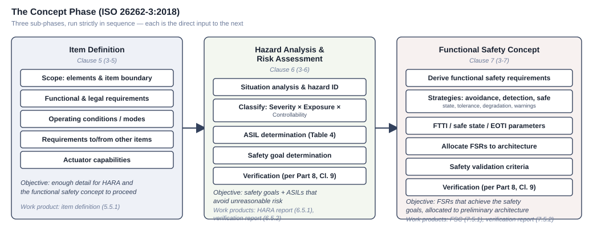

## 3-5 Item Definition (Clause 5)

**Objective** (Clause 5.1): 
  * define and describe the item - its functionality, dependencies on and interaction with the driver, 
  * the environment and other items - with enough detail that whoever runs the next two sub-phases (HARA, functional safety concept) has what they need (Clause 5.2).

The item definition must address two groups of content (Clause 5.4):

**The item's requirements** (Clause 5.4.1):
  - legal/regulatory requirements and applicable standards;
  - functional behaviour at the vehicle level (incl. operating modes/states);
  - required quality, performance and availability;
  - constraints (functional dependencies, dependencies on other items, operating environment);
  - potential consequences of behavioural shortfalls, including known failure modes/hazards (which can
    include known safety-related incidents on similar items, Note 3); and
  - the actual or assumed capabilities of the actuators (torque, force, speed, brightness, loudness, etc. -
    these feed directly into the severity/controllability judgment made later in the HARA, Note 4).

**The item's boundary, interfaces and interaction assumptions** (Clause 5.4.2):
  - the item's elements (which can be based on other technologies, Note 1);
  - assumptions about the item's effect on vehicle behaviour;
  - functionality the item requires from, or provides to, other items/elements;
  - how functions are allocated/distributed across systems; and
  - the operational scenarios affecting the item's functionality.

  With growing vehicle complexity, one item can be realized across an array of systems that are themselves items in their own right (Note 2) - e.g. a combined ACC + lane-keeping function spans braking, steering and propulsion systems, and the braking system's own service-braking function is an item in its own right
  (Example).

**Work product**: the item definition itself (Clause 5.5.1).

## 3-6 Hazard Analysis and Risk Assessment (Clause 6)

**Objective** (Clause 6.1): 
  * identify and classify the hazardous events caused by the item's *malfunctioning* behaviour, 
  * then formulate safety goals with ASILs that prevent/mitigate them. 
  
The ASIL is derived purely from the item's functional behaviour (severity × exposure × controllability) - the detailed design doesn't need to exist yet (Clause 6.2).

**Initiation** (Clause 6.4.1) - HARA is based on the item definition, and it evaluates the item *without*
any internal safety mechanisms - mechanisms planned or already implemented in predecessor items are
deliberately excluded here and only reappear later in the functional safety concept (6.4.1.1-6.4.1.2,
Note 2). Available and sufficiently independent *external* measures can still be credited (Note 1, e.g.
electronic stability control mitigating a chassis-system failure).

**Situation analysis and hazard identification** (Clause 6.4.2):
  - describe the operational situations and operating modes where a malfunction becomes hazardous, for
    both correct use and reasonably foreseeable misuse (6.4.2.1);
  - hazards are identified systematically from possible malfunctioning behaviour - FMEA and HAZOP are the
    suitable techniques, supported by brainstorming, checklists, quality history and field studies
    (6.4.2.2, Note 1);
  - hazards are always defined at the **vehicle level**, not down at implementation level - a given hazard
    can have many implementation-level causes that simply don't need enumerating here (6.4.2.3);
  - the taxonomy of what a malfunction actually looks like: loss of function, incorrect function
    (more/less/wrong-direction than intended, or output stuck at a value), or unintended function;
  - combined effects matter too - losing one function can knock out several others simultaneously
    (6.4.2.6, e.g. an electrical power-supply failure taking down engine torque, power steering *and*
    forward illumination together); and
  - one easy-to-miss trap: describing operational situations at *too fine* a granularity can artificially
    depress the exposure class and thus under-state the ASIL - similar situations should be aggregated to
    avoid this (6.4.2.7).

  A practical checklist for scoping "operational situations" (per SAE J2980, not itself part of
  ISO 26262 but a common way to structure the analysis): location (highway, city, parking lot, ...),
  road conditions (friction, incline, width), driving manoeuvres (start-up, turning, evasive lane
  change, ...), vehicle state (accelerating, coasting, parked, collision, ...), other considerations
  (side wind, oncoming traffic, pedestrians, traffic jam), and other-vehicle characteristics (trailer
  attached, heavily laden, fault codes present).

**Classification of hazardous events** (Clause 6.4.3) - every identified hazardous event gets classified
  on three axes, each conservatively rounded up whenever there's reasonable doubt (6.4.3.1, Note):

  **Table 1 - Classes of severity (Clause 6.4.3.2)**

  | S0 | S1 | S2 | S3 |
  |---|---|---|---|
  | No injuries | Light and moderate injuries | Severe and life-threatening injuries (survival probable) | Life-threatening injuries (survival uncertain), fatal injuries |

  The Abbreviated Injury Scale (AIS) underpins this classification (Annex B); S0 may be assigned only when
  consequences are clearly limited to material damage, in which case **no ASIL assignment is required**
  (6.4.3.4). AIS itself is an external six-point medical injury scale (not defined by ISO 26262, just
  referenced) that the S-classes map onto by probability threshold:

  | AIS | Injury description |
  |---|---|
  | 0 | No injury |
  | 1 | Minor (superficial wounds, muscle pain) |
  | 2 | Moderate (deep flesh wounds, concussion with <15 min unconsciousness, uncomplicated long-bone/simple rib fracture) |
  | 3 | Serious, not life-threatening (skull fracture without brain injury, spinal dislocation below C4 without cord involvement, multiple rib fractures without paradoxical breathing) |
  | 4 | Serious, life-threatening, survival probable (concussion with/without skull fracture and up to 12 h unconsciousness, paradoxical breathing) |
  | 5 | Critical, survival uncertain (spinal fracture below C4 with cord involvement, myocardial/intestinal rupture, >12 h unconsciousness incl. intracranial bleeding) |
  | 6 | Untreatable/fatal (cervical spine fracture above C3 with cord involvement, severe open two-cavity injuries) |

  **Table 2 - Classes of probability of exposure (Clause 6.4.3.5)**

  | E0 | E1 | E2 | E3 | E4 |
  |---|---|---|---|---|
  | Incredible | Very low probability | Low probability | Medium probability | High probability |

  E1-E4 step by an order of magnitude each (Note 1); exposure is estimated per operational situation and
  explicitly does **not** consider how many vehicles carry the item (6.4.3.6). E0 needs a recorded rationale
  for why the situation is excluded as incredible (6.4.3.7, e.g. force majeure) and likewise needs no ASIL.

  **Table 3 - Classes of controllability (Clause 6.4.3.8)**

  | C0 | C1 | C2 | C3 |
  |---|---|---|---|
  | Controllable in general | Simply controllable | Normally controllable | Difficult to control or uncontrollable |

  Controllability assumes a driver in fit condition, licensed, and complying with traffic law (Note 2); C0
  needs no ASIL (6.4.3.9).

  **Table 4 - ASIL determination (Clause 6.4.3.10)**

  | Severity | Exposure | C1 | C2 | C3 |
  |---|---|---|---|---|
  | S1 | E1 | QM | QM | QM |
  | S1 | E2 | QM | QM | QM |
  | S1 | E3 | QM | QM | A |
  | S1 | E4 | QM | A | B |
  | S2 | E1 | QM | QM | QM |
  | S2 | E2 | QM | QM | A |
  | S2 | E3 | QM | A | B |
  | S2 | E4 | A | B | C |
  | S3 | E1 | QM | QM | Aᵃ |
  | S3 | E2 | QM | A | B |
  | S3 | E3 | A | B | C |
  | S3 | E4 | B | C | D |

  ᵃ Footnote (Clause 6.4.3.11): if several *unlikely* situations are combined such that the resulting
  exposure is lower than E1, QM may be argued for S3/C3 off that combination - e.g. a crash that deploys the
  airbag, *and* the vehicle partly submerged, *and* a high-voltage system exposed without an internal short
  (Example 1); or a crash deploying the airbag *and* an intact tank *and* a broken fuel line dripping onto
  hot parts *and* a fully functional pump (Example 2). QM here means ISO 26262 compliance isn't required,
  though the hazardous event can still carry safety requirements handled through quality processes
  (Note 2 under 6.4.3.10).

**Determination of safety goals** (Clause 6.4.4):
  - one safety goal per hazardous event that has an ASIL; similar safety goals may be combined into one,
    in which case the combined goal inherits the **highest** ASIL among them (6.4.4.1-6.4.4.2);
  - safety goals are top-level safety requirements expressed as *functional objectives*, never as
    technological solutions (Note), and are specified per ISO 26262-8:2018, Clause 6 (6.4.4.3) - which is
    where the commonly cited "attributes of a safety goal" (ASIL, safe state, fault tolerant time interval,
    warning concept, degradation concept) actually live; and
  - assumptions used in, or resulting from, the HARA - including for hazardous events classified QM or
    with no ASIL - must be identified and are validated later during safety validation (6.4.4.4).

**Management of T&B variances in HARA** (Clause 6.4.5, Truck & Bus only) - three variance types must be considered:
  1. type of base vehicle,
  2. T&B vehicle configuration,
  3. T&B vehicle operation (6.4.5.2), chosen by engineering judgement.

  * Worked examples: 
    * an unloaded truck's wheel-spin risk affects exposure differently than a loaded one (Example 1); 
    * an attached trailer can reduce a driver's controllability versus no trailer (Example 2); 
    * different T&B bodies carry different severity profiles (Example 3). 
    * As with the general case, neither the count of a given base-vehicle type nor the count of vehicles in a specific configuration factor into the exposure estimate (6.4.5.4-6.4.5.5).

**Verification** (Clause 6.4.6) - the HARA (safety goals included) is verified per ISO 26262-8:2018,
Clause 9, to evidence:
  - appropriate selection of operational situations/hazard identification (and, for T&B, vehicle
    configuration);
  - compliance with the item definition;
  - consistency with other items' HARAs;
  - completeness of hazardous-event coverage; and
  - consistency between safety goals, their ASILs and the hazardous events they cover.

**Work products** (Clause 6.5):

* HARA report (6.5.1)
* HARA verification report (6.5.2)

## 3-7 Functional Safety Concept (Clause 7)

**Objectives** (Clause 7.1):

* specify the item's functional (or degraded) behaviour needed to meet its safety goals;
* specify fault detection/control strategies;
* specify item-level fault-tolerance/mitigation strategies (by the item, the driver, or external
  measures);
* allocate the resulting functional safety requirements (FSRs) to the system architectural design or to
  external measures; and
* verify the concept while specifying safety validation criteria.

**General** (Clause 7.2) 
  * the functional safety concept contains the safety measures (including safety mechanisms) that get implemented in the item's architectural elements and written up as **FSRs**. 
  * Preliminary architectural assumptions are used here specifically to let this phase proceed before the architecture has
  matured (Clause 7.2). 
  * FSRs are specified per ISO 26262-8:2018, Clause 6 (7.4.1) - same hierarchical structure/attributes/traceability rules already covered under the Part 8 section above. 

**Derivation of FSRs** (Clause 7.4.2) - derived from the safety goals, considering the system architectural
  design (7.4.2.1); at least one FSR per safety goal, though one FSR can also satisfy several goals at once
  (7.4.2.2). Where applicable, FSRs specify strategies for (Clause 7.4.2.3):
  - a) fault avoidance;
  - b) fault detection and control of faults or their resulting malfunctioning behaviour;
  - c) transitioning to (and, if applicable, from) a safe state;
  - d) fault tolerance;
  - e) degradation of functionality in the presence of a fault (e.g. limp-home mode until ignition is cycled off, Example);
  - f) driver warnings that reduce risk-exposure time to an acceptable duration;
  - g) driver warnings that increase the driver's controllability (eg. an engine malfunction lamp, ABS warning lamp);
  - h) how the vehicle-level fault tolerant time interval gets met, by defining a fault handling time interval;
  - i) avoiding/mitigating a hazardous event caused by improper arbitration between multiple simultaneous control requests from different functions.

  (c), (e), (f) and (g) together typically form the warning-and-degradation strategy (Note). 
  
  * Each individual FSR is specified considering operating modes, fault tolerant time interval, safe states, emergency
  operation time interval, and functional redundancies 
  * FTA/FMEA/HAZOP can support deriving a complete set
  (7.4.2.4). 
  * If a safe state is reachable, it's specified explicitly (7.4.2.5); if it *can't* be reached within an acceptable interval, an emergency operation is specified instead (7.4.2.6). 
  * Any assumed driver/other-person actions needed to prevent a safety-goal violation must be written into the concept, along with the means available to that person to actually perform them (7.4.2.7, e.g. an ACC brake activation being overridden when the driver presses the accelerator).
  
**FSR Allocation** (7.4.2.8) - FSRs are allocated to system architectural elements, inheriting ASIL (and the 7.4.2.4 attributes) from the parent safety goal, with ISO 26262-9:2018 Clause 5 governing ASIL decomposition where used. 
  
  * If **freedom from interference** (ISO 26262-9:2018, Clause 6) between elements can't be argued, all of them are developed to the *highest* ASIL among the requirements involved.
  * Multi-E/E-system items get FSRs specified and allocated per individual E/E system, with random-hardware fault-metric targets allocated accordingly (per ISO 26262-4:2018, 6.4.5.2).

**Elements of other technologies** (7.4.2.9) - their FSRs are derived/allocated to the corresponding architecture elements, interface FSRs are specified, implementation is ensured by measures outside ISO 26262's scope, and (as a rule) no ASIL is assigned to these requirements - evidence of adequacy comes from safety validation instead (ISO 26262-4:2018, Clause 8).

**External measures** (7.4.2.10) - same pattern: derive/communicate the FSRs implemented externally, specify the interface FSRs, and if the external measure happens to be an E/E system itself, address its FSRs through ISO 26262 properly.

**Safety validation criteria** (Clause 7.4.3) - acceptance criteria for safety validation are specified from the FSRs and the safety goals (7.4.3.1); this validation runs throughout development, not only at the very end (Note 2).

**Verification of the functional safety concept** (Clause 7.4.4) - verified per ISO 26262-8:2018, Clause 9, for consistency/compliance with the safety goals and for its ability to mitigate or avoid the hazards (7.4.4.1). 
  * A traceability-based argument is valid here: if the item complies with its FSRs, it complies with the safety goals (Note 3). 
  * The mitigation/avoidance check can reuse validation-style methods (tests,trials, prototypes, simulations, expert judgement) and should address both transient and permanent fault behaviour (Note 1-2).

**Work products** (Clause 7.5):

* Functional safety concept (7.5.1)
* Functional safety concept verification report (7.5.2)

# ISO 26262-8 - Supporting processes

Part 8 holds the process activities that are *reused across* the other parts, rather than being tied to one
safety-lifecycle phase. It is organized as Clauses 5-16 (ref. ISO 26262-8:2018 Table of Contents /
Annex A overview diagram):

| Clause | Topic |
|---|---|
| 5 | Interfaces within distributed developments |
| 6 | Specification and management of safety requirements |
| 7 | Configuration management |
| 8 | Change management |
| 9 | Verification |
| 10 | Documentation management |
| 11 | Confidence in the use of software tools |
| 12 | Qualification of software components |
| 13 | Evaluation of hardware elements |
| 14 | Proven in use argument |
| 15 | Interfacing an application that is out of scope of ISO 26262 (Truck & Bus only) |
| 16 | Integration of safety-related systems not developed according to ISO 26262 (Truck & Bus only) |

Clauses 7 (Configuration management), 8 (Change management) and 10 (Documentation management) are
general project-hygiene processes (unique identification/reproducibility of work products, ISO 26262-8:2018,
Clause 7.1; controlled analysis and implementation of changes to safety-related work products, Clause 8.1;
a repeatable documentation strategy for the whole lifecycle, Clause 10.1) - not detailed further here.

## 8-5 Interfaces within Distributed Developments (Clause 5)

**Objective** (Clause 5.1): define the interactions/dependencies between a customer (e.g. OEM) and a
supplier, allocate responsibilities, and identify which work products get exchanged, for item/element
development that is split across organizations.

* Applies at **every tier** of the customer-supplier chain, including subcontracts taken out by the supplier
  or by its subcontractors in turn (Clause 5.4.1.2) - so a DIA network can be a 2-party or a multi-tier
  agreement depending on how deep the supply chain goes. Internal ("in-house") suppliers can be managed
  the same way as external ones (Clause 5.4.1.2, Note 2).
* Subcontractor relationships are explicitly permitted; the customer's in-house safety planning, execution
  and documentation procedures are mirrored for the distributed case (Clause 5.2).
**Supplier selection criteria** (Clause 5.4.2.1-5.4.2.2) - the customer evaluates the supplier's capability
to develop/produce items of comparable complexity and ASIL, considering the supplier's quality
management system, past performance, prior functional safety assessments (per ISO 26262-2:2018, 6.4.12),
and its response to the RFQ (which itself must carry a formal request to comply with ISO 26262, scope of
supply, safety goals/ASIL if known, and failure-rate/diagnostic-coverage targets per ISO 26262-4:2018,
6.4.5.3).

**Development Interface Agreement (DIA)** - the customer and supplier jointly specify a DIA covering
(Clause 5.4.3.1):
  - appointment of both safety managers;
  - joint tailoring of safety activities (per ISO 26262-2:2018, 6.4.5);
  - split of safety-lifecycle activities between the two parties;
  - the work products to be shared (incl. reviews);
  - RASIC-style responsibility assignment per activity (Note 5 - "Responsible, Accountable, Support,
    Inform, Consult");
  - target values for hardware metrics;
  - interface tools/processes;
  - who performs safety validation (ISO 26262-4);
  - functional safety assessment planning; and
  - audit rights at the supplier's premises.

  An example DIA is in Annex B.

**Execution of distributed development** (Clause 5.4.4):
  - the customer supplies information/data in time for the agreed activities;
  - the supplier reports risks of DIA non-compliance and safety anomalies as they occur, and both parties
    agree who resolves them;
  - the supplier checks the customer's safety requirements are feasible per 6.4.1/6.4.2 and flags anything
    infeasible for re-examination; and
  - progress is reported against the safety plan's milestones.

**Functional safety assessment (FSA) in a distributed development** (Clause 5.4.5) - triggers when the
highest ASIL of the allocated safety requirements is (B), C or D: the DIA must name who runs the FSA
(supplier itself, customer, or a third party designated by either), plan it, and the supplier must deliver
FSA reports (compliance with received safety requirements + adequacy of implemented processes) that are
made available to both sides.

**After SOP** (Clause 5.4.6, "Agreement for production, operation, service and decommissioning"):
  - the supplier evidences that production process capability is met/maintained per ISO 26262-2:2018
    Clause 7 and ISO 26262-7:2018 Clauses 5-6; and
  - the supply agreement fixes safety responsibilities (ISO 26262-2:2018, 7.4.2.1), access to
    production-monitoring records for safety-related special characteristics, and timely communication
    channels for safety-related field events (analysed per the field-monitoring process, covering similar
    items/other affected parties).

**Work products** (Clause 5.5):
  - supplier selection report (5.4.2.1-5.4.2.2);
  - DIA (5.4.3, 5.4.5.1-5.4.5.2);
  - supplier's safety plan (5.4.3-5.4.4);
  - functional safety assessment report (5.4.5.3-5.4.5.4); and
  - supply agreement (5.4.6.1-5.4.6.4).

## 8-6 Specification and Management of Safety Requirements (Clause 6)

**Objectives** (Clause 6.1): get the *content* of safety requirements right (attributes/characteristics), and
manage them *consistently* across the whole safety lifecycle.

**Safety requirements** are specified and refined through a hierarchical structure spanning the concept and
  product-development phases (Clause 6.2, Figure 2) - ***safety goals*** (ISO 26262-3, Clause 6) -> functional
  safety requirements (ISO 26262-3, Clause 7) -> ***technical safety requirements*** (ISO 26262-4, Clause 6) ->
  hardware/software safety requirements (ISO 26262-5, Clause 6 / ISO 26262-6, Clause 6). 
  
  * The mapping between levels is many-to-many: one FSR can satisfy several safety goals, and one safety goal can spawn several
  FSRs, with each FSR inheriting an ASIL and carrying its own allocation to an element:

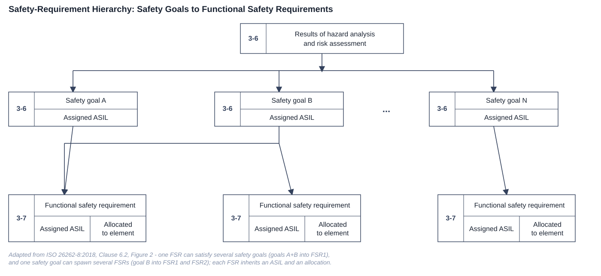

**Specification method** (Clause 6.4.1, Table 1) - an appropriate combination of natural language plus informal/semi-formal/formal notation, weighted by ASIL and by how much precision the requirement needs(higher-level requirements read fine in natural language; lower-level HW/SW behaviour benefits from semi-formal notations such as UML/SysML for extra clarity).

**Characteristics every safety requirement must have** (Clause 6.4.2.4): unambiguous, comprehensible,
  atomic/singular, internally consistent, feasible and achievable, verifiable, necessary,
  implementation-free, complete, and conforming (to applicable standards). Worked examples:
  - *Atomic* - "The warning telltale is orange during the startup phase, which takes at most one minute"
    mixes two requirements and should split into "the telltale is orange during startup" + "startup takes at
    most one minute" (Clause 6.4.2.4 c), Note 4).
  - *Feasible* - "The car shall stop at once when the driver applies the brakes" isn't feasible because
    "at once" ignores physical/resource constraints (Clause 6.4.2.4 e), Note 6).
  - *Verifiable* - "The voice controller shall sound pleasing to the ear" only becomes verifiable once tied
    to a measurable proxy, e.g. a positive customer-survey score (Clause 6.4.2.4 f), Note 8-9).
  - *Internally consistent* - "The telltale is orange for a minimum of 100 seconds during the 1-minute
    startup phase" contradicts itself if startup is shorter than 100 s (Clause 6.4.2.4 d), Note 5).
  - *Implementation-free* - "The system shall sort packages" vs. "...using QuickSort" - the latter bakes in
    a design decision the requirement shouldn't dictate (Clause 6.4.2.4 h), Note 12).

**Attributes every safety requirement must carry** (Clause 6.4.2.5): a unique ID that never changes
  through the lifecycle, a status (proposed / assumed / accepted / reviewed / delivered / verified), and an
  ASIL. Requirements also inherit their ASIL from their parent unless ASIL decomposition is applied per
  ISO 26262-9 (Clause 6.4.2.2), and must be allocated to the item/element that implements them
  (Clause 6.4.2.3).

**Management of the requirement set** (Clause 6.4.3.1): hierarchical structure, organizational grouping,
  completeness (each level fully implements the level above), external consistency (no contradictions
  *between* requirements), no duplication, and maintainability.

**Traceability** (Clause 6.4.3.2) - each requirement traces to its source at the next-higher level, to its
  derived requirements/design realization at the next-lower level, and to its verification specification
  (Clause 9.4.2). This underpins impact analysis on change and functional safety assessment (Note 2).

**Verification of the requirements themselves** (Clause 6.4.3.3, Table 2) uses an appropriate combination
  of verification methods, on top of whatever part-specific verification each hierarchy level demands:

**Table 2 - Methods for the verification of safety requirements (Clause 6.4.3.3)**

  | Method | ASIL A | ASIL B | ASIL C | ASIL D |
  |---|---|---|---|---|
  | 1a Verification by walk-through | ++ | + | o | o |
  | 1b Verification by inspection | + | ++ | ++ | ++ |
  | 1c Semi-formal verification | + | + | ++ | ++ |
  | 1d Formal verification | o | + | + | + |

  The pattern mirrors Table 1: lightweight review (walk-through) is favoured at low ASIL and drops off by
  ASIL C/D, while inspection and semi-formal verification pick up the slack at the higher ASILs; formal
  verification is never more than "recommended" even at ASIL D, since it's typically reserved for the
  requirements where the extra rigor is actually tractable.

**Work products** (Clause 6.5): the specified safety requirements themselves (6.5.1), each with its
traceability and verification information.

## 8-9 Verification (Clause 9)

**Objective** (Clause 9.1): ensure work products comply with their requirements. This is a generic process that
gets instantiated by each phase of the lifecycle (ISO 26262-3 through -7); safety *validation* is a separate,
out-of-scope activity handled in ISO 26262-4:2018, Clause 8 (Clause 9.2, Note).

**Verification planning** (Clause 9.4.1.1) must address:
  - the work-product content to verify;
  - the verification objective;
  - the methods (review/walkthrough/inspection/simulation/test...);
  - pass/fail criteria;
  - the verification environment (test or simulation, if applicable);
  - equipment/tools used;
  - the resources needed;
  - actions to take on anomalies; and
  - a regression strategy (full or partial re-verification after a change).

  Planning should also weigh method adequacy, work-product complexity, prior verification experience
  (including service history / proven-in-use maturity), and technology maturity/risk (Clause 9.4.1.2).

**Verification specification** (Clause 9.4.2.1) selects and specifies review/analysis checklists,
  simulation scenarios, or test cases/data/objects. For testing specifically (Clause 9.4.2.2), each test
  case needs:
  - a unique ID;
  - a reference to the verified work product's version;
  - preconditions/configuration;
  - environmental conditions;
  - input data (with timing/values); and
  - expected behaviour (output, tolerance, timing) plus pass/fail criteria.

  Test cases are grouped by test method (Clause 9.4.2.3) and should be reviewed by someone other than the
  work product's author (Clause 9.4.2.4).

**Verification execution and evaluation** (Clause 9.4.3.1-9.4.3.2) runs as planned/specified, ideally by a
  different person than the work-product author. The evaluation report (Clause 9.4.3.3) must capture:
  - the verified work product's ID;
  - references to the plan/specification;
  - the verification environment/tool configuration and any calibration data;
  - the compliance level against expected results;
  - an unambiguous pass/fail statement (with rationale and suggested changes on failure); and
  - the reasons for any steps not executed.

  Test equipment itself must deliver valid, reproducible results under the applicable quality management
  system (Clause 9.4.3.4).

## 8-11 Confidence in the Use of Software Tools (Clause 11)

**Purpose** (Clause 11.1): (a) determine how much confidence a software tool needs, and (b) qualify it so there's
evidence the tool can be relied on for the ISO 26262 activities/tasks it supports - i.e. that a malfunctioning
tool won't silently introduce or hide errors in the safety-related item (Clause 11.2).

**Tool Confidence Level (TCL) determination** (Clause 11.4.5, Table 3) is driven by two classifications:
  - **Tool Impact (TI)**: TI1 if there's an argument the tool *cannot* introduce/miss errors in the
    developed item; TI2 otherwise (Clause 11.4.5.2 a).
  - **Tool error Detection (TD)**: TD1 = high confidence a malfunction/erroneous output would be
    prevented or detected; TD2 = medium confidence; TD3 = everything else, i.e. only random detection
    (Clause 11.4.5.2 b). If TI/TD is unclear, estimate conservatively (Clause 11.4.5.3).

**Table 3 - Determination of the Tool Confidence Level (Clause 11.4.5.4)**

  | Tool Impact (TI) | TD1 (high confidence) | TD2 (medium confidence) | TD3 (everything else) |
  |---|---|---|---|
  | **TI1** - no possibility the tool introduces/misses errors | TCL1 | TCL1 | TCL1 |
  | **TI2** - possibility exists | TCL1 | TCL2 | TCL3 |

**What each TCL then requires (Clause 11.4.6.1)**

  | TCL | Meaning | Qualification required |
  |---|---|---|
  | **TCL1** | Tool cannot cause, or has strong detection against, malfunction-driven errors | None |
  | **TCL2** | Some risk of undetected malfunction-driven errors | Methods of Table 5 (weighted lighter per ASIL) |
  | **TCL3** | Highest risk - malfunction likely to introduce/miss errors with only weak detection | Methods of Table 4 (stricter, same method list as TCL2 but weighted heavier per ASIL) |

**Qualification requirement by TCL** (Clause 11.4.6.1): TCL1 needs no qualification; TCL2 uses the
  methods in Table 5; TCL3 uses the (stricter) methods in Table 4.

**Table 4 - Qualification of software tools classified TCL3 (Clause 11.4.6.1)**

  `++` = highly recommended, `+` = recommended (not mutually exclusive - an appropriate combination is used).

  | Method | ASIL A | ASIL B | ASIL C | ASIL D |
  |---|---|---|---|---|
  | 1a Increased confidence from use (Clause 11.4.7) | ++ | ++ | + | + |
  | 1b Evaluation of the tool development process (Clause 11.4.8) | ++ | ++ | + | + |
  | 1c Validation of the software tool (Clause 11.4.9) | + | + | ++ | ++ |
  | 1d Development in accordance with a safety standard | + | + | ++ | ++ |

  At TCL3, low ASILs (A/B) lean on the cheaper process-trust methods (1a/1b - "we've used this tool a lot"
  or "the tool vendor followed a recognized process"), while high ASILs (C/D) are pushed toward the harder
  direct-evidence methods (1c/1d - actually validating the tool, or building it to a safety standard).

**Table 5 - Qualification of software tools classified TCL2 (Clause 11.4.6.1)**

  | Method | ASIL A | ASIL B | ASIL C | ASIL D |
  |---|---|---|---|---|
  | 1a Increased confidence from use (Clause 11.4.7) | ++ | ++ | ++ | + |
  | 1b Evaluation of the tool development process (Clause 11.4.8) | ++ | ++ | ++ | + |
  | 1c Validation of the software tool (Clause 11.4.9) | + | + | + | ++ |
  | 1d Development in accordance with a safety standard | + | + | + | + |

Table 5 vs. Table 4: TCL2 is the lower-risk tier, so it keeps trusting 1a/1b (`++`) all the way up through
  ASIL C - only ASIL D at TCL2 drops them to `+`. TCL3 drops that trust a whole ASIL level earlier, at ASIL C
  already. Column 1d never goes above `+` at TCL2 (building a tool to a full safety standard is treated as
  overkill for the lower-risk tier), whereas TCL3/ASIL C-D pushes it to `++`.

Both tables recommend a combination of:
  - *Increased confidence from use* (Clause 11.4.7) - only valid if the tool was previously used for the
    same purpose/comparable use cases/environment, backed by sufficient accumulated usage data, an
    unchanged tool specification, and systematically tracked malfunction history; valid only for the
    exact evaluated tool version (Clause 11.4.7.1-11.4.7.4). Note: this is *not* the same as the Clause 14
    proven-in-use argument (Clause 11.4.7.2, Note).
  - *Evaluation of the tool development process* (Clause 11.4.8) - the tool's own development process is
    assessed against a recognized standard (e.g. Automotive SPICE, ISO/IEC 33000, CMMI) (Clause 11.4.8.2-
    11.4.8.3).
  - *Validation of the software tool* (Clause 11.4.9) - direct evidence the tool meets its specified
    purpose, with malfunctions analysed for consequences/mitigations and anomalous-condition behaviour
    examined (Clause 11.4.9.2).
  - *Development in accordance with a safety standard* (e.g. ISO 26262, IEC 61508, EN 50128, DO-178C),
    using a relevant subset of that standard's requirements (Table 4/5, footnote a).
* Qualification must be documented with tool ID/version, the TCL and its evaluation basis, the max ASIL
  it's qualified for, its configuration/environment, who qualified it, the methods used, results, and any
  usage constraints found (Clause 11.4.6.2). A predetermined TCL/qualification done independently of a
  specific project must be re-validated before reuse on a new safety-related item (Clause 11.4.2).

## 8-12 Qualification of Software Components (Clause 12)

**Purpose** (Clause 12.1): provide evidence that a software component is suitable for reuse, so teams don't
have to redevelop identical functionality and can use general-purpose COTS software instead (Clause 12.2).
Covers COTS libraries, in-house components already used on other ECUs, or generic reusable components -
examples given: graphical/maths libraries, operating systems and OS services, databases, device drivers
(Clause 12.2, Example).

* To call a component "qualified", the following must all exist (Clause 12.4.1):
  - a specification (12.4.2.1);
  - evidence it meets its requirements (12.4.2.2-12.4.2.4);
  - evidence it's suitable for its intended use (12.4.3);
  - evidence its development process follows a recognized standard (e.g. ISO/IEC/IEEE 12207); and
  - a qualification plan.
**Specification content** (Clause 12.4.2.1):
  - unique ID;
  - max target ASIL if the component misbehaves;
  - the qualification activities to run;
  - the component's requirements (functional, accuracy/numerical, failure behaviour, response time,
    resource usage, runtime-environment needs, overload robustness);
  - intended-use requirements;
  - configuration description;
  - interfaces/shared resources;
  - application manual;
  - integration instructions;
  - anomalous-condition reactions; and
  - known-anomaly workarounds.
**Verification of qualification** (Clause 12.4.2.2) - must show requirements-based coverage per
  ISO 26262-6:2018, Clause 9, cover both normal operation and failure behaviour, and show no known errors
  that could violate the component's allocated safety requirements. **For ASIL D specifically**
  (Clause 12.4.2.3), structural coverage must additionally be measured (again per ISO 26262-6:2018,
  Clause 9) to judge test-case completeness. This verification is only valid for an **unchanged**
  implementation of the component (Clause 12.4.2.4).

Qualification must be documented (Clause 12.4.2.5):
  - component ID and configuration;
  - who qualified it;
  - the qualification environment;
  - verification results; and
  - the max ASIL of its allocated safety requirements.

  The qualification result itself is then verified per Clause 9 (Clause 12.4.3).

## 8-13 Evaluation of Hardware Elements (Clause 13)

**Purpose** (Clause 13.1): ensure a hardware element's functional behaviour is adequate to meet its allocated
safety requirements, so the risk of a safety-goal/requirement violation from a *systematic* fault in that
element is sufficiently low. This is an alternative compliance route to ISO 26262-5 for COTS or custom
hardware elements that weren't originally developed to ISO 26262 (random-fault handling is still the
integrator's job at the next level up, Clause 13.1, Note 1-2).

**Classification** (Clause 13.4.1.1) - every evaluated hardware element is placed in one of three classes:
  - **Class I** - at most a few fully characterizable/testable states, safety-related failure modes
    identifiable without knowing implementation details, and no internal safety mechanisms relevant to the
    safety concept. *Example: resistor, capacitor, transistor, diode, quartz, resonator.*
  - **Class II** - few operating modes/small value ranges/few parameters, analysable from available
    documentation (datasheets, manuals, app notes) without implementation details, still no relevant
    internal safety mechanisms. *Example: fuel-pressure sensor, temperature sensor, stand-alone ADC without
    internal safety mechanisms.*
  - **Class III** - many operating modes/wide ranges/many parameters that can't be analysed without
    implementation knowledge, or that has internal safety mechanisms relevant to the safety concept.
    *Example: microprocessor, microcontroller, DSP.*

**Class I evaluation** (Clause 13.4.2) - not evaluated standalone; the hardware element it's integrated
  into must simply be developed to ISO 26262.

**Class II evaluation** (Clause 13.4.3) - analysis and testing, per an evaluation plan (unique ID/version,
  intended-use environment, strategy/rationale, tools/equipment, responsible party, pass/fail criteria -
  Clause 13.4.3.2). A comprehensive argument that functional performance meets spec must combine analytical
  methods/assumptions, operational-experience data, and existing test results, with a rationale for each
  assumption/extrapolation (Clause 13.4.3.3.1-13.4.3.3.3). Analyses must cover all relevant environmental
  conditions and stresses (Clause 13.4.3.4); tests need a test plan (functions, allocated safety
  requirements, test sequence/traceability, assembly/connection requirements, environmental conditions,
  sample count, pass/fail criteria, equipment accuracy - Clause 13.4.3.5.1) and robustness testing per
  ISO 26262-5:2018, 10.4.6 (e.g. based on ISO 16750). The evaluation report states pass/fail against the
  allocated safety requirements and is itself verified per Clause 9 (Clause 13.4.3.6).
**Class III evaluation** (Clause 13.4.4) - developing to ISO 26262 is preferred; evaluation is a fallback.
  Class III must meet all Class II requirements *plus* additional measures showing the systematic-fault
  risk is sufficiently low, e.g. (Clause 13.4.4.3):
  - verifiability of the safety-related functionality;
  - field experience / "well-trusted component" (a partial argument only - a *full* proven-in-use argument
    follows Clause 14 instead);
  - supervision by an independent, diverse element that can detect the relevant failure modes
    (independence shown via a Dependent Failure Analysis per ISO 26262-9:2018, Clause 7); or
  - development to a different safety standard with comparable integrity.

## 8-14 Proven-in-Use Argument (Clause 14)

**Purpose** (Clause 14.1): an alternate compliance route for reusing an existing item/element (or related work
product) where field data already exists, applicable when the candidate's definition and conditions of use
are identical or near-identical to something already released and in service (Clause 14.2).

**Candidate description required** (Clause 14.4.3): identification/traceability, fit/form/function
  requirements, and the safety requirements/ASILs the candidate met in its previous use.
* Any candidate modification must be analysed (Clause 14.4.4) and the credit only survives if the
  configuration/change management trail proves the current status of the candidate (Clause 14.4.5.1).

**Target values** (Clause 14.4.5.2, using a single-sided 70% confidence chi-square bound) - if no ASIL is
  yet assigned, assume ASIL D conservatively (Clause 14.4.5.2, Note):

  | ASIL | Limit for observable incident rate (Table 6) | Minimum evaluation period w/o incident (Table 7) |
  |---|---|---|
  | D | < 10⁻⁹ /h | 1.2 × 10⁹ h |
  | C | < 10⁻⁸ /h | 1.2 × 10⁸ h |
  | B | < 10⁻⁸ /h | 1.2 × 10⁸ h |
  | A | < 10⁻⁷ /h | 1.2 × 10⁷ h |

  An "observable incident" is a failure reported to the manufacturer, caused by the candidate, with the
  potential to violate a safety goal (Clause 14.4.5.2.4, Note 1). If incidents *are* observed, the required
  minimum evaluation period is recalculated from the chi-square relation in Clause 14.4.5.2.4, Note 4, rather
  than used as a hard reject.

## 8-15 Interfacing an Application Out of Scope of ISO 26262 (Clause 15) - Truck & Bus only

**Purpose** (Clause 15.1): give confidence that an application *outside* ISO 26262's scope cannot violate the
safety goals of a base vehicle/item that *was* developed to ISO 26262 - the classic commercial-vehicle case
of a body/equipment integrator assembling a complete vehicle under a different standard (Clause 15.2, e.g. a
body builder under the Machinery Directive, or agricultural equipment under farm-machinery standards).

* The base vehicle manufacturer/supplier must tell the integrator which systems/components are modifiable
  and the permitted safety limits for those modifications, and must communicate the safety measures the
  integrator has to apply - assuming the integrator has the capability to realize them, e.g. via compliance
  with another safety standard, an appropriate safety culture, and an established QMS (Clause 15.4.2-15.4.3).
* Worked example (Clause 15.4.3, Example 2): a body builder requests PTO activation during driving; both
  sides agree an ASIL-to-Performance-Level mapping under ISO 13849, the OEM communicates the ASIL-rated
  requirement, and the body builder complies at the agreed Performance Level before the OEM enables the PTO
  function.

## 8-16 Integration of Safety-Related Systems Not Developed per ISO 26262 (Clause 16) - Truck & Bus only

**Purpose** (Clause 16.1): the mirror image of Clause 15 - give confidence that a system/component developed to
*another* safety standard (not ISO 26262) still reaches the functional-safety level needed once integrated
into an ISO 26262 item (Clause 16.2, e.g. Machinery Directive / IEC 61508 / ISO 13849 / ISO 25119 content).

* The integrator must justify, in its safety case, why this clause applies (Clause 16.4.2), then define the
  criteria for arguing the other-standard system meets the required functional-safety level - e.g. an
  ASIL-to-Performance-Level mapping, or a comparison of methods/failure-rate targets across the two standards
  (Clause 16.4.3).
* Integrator and supplier then agree the measures used to verify those criteria (Clause 16.4.4), e.g.:
  - availability of the integrated system's specification;
  - test-report evidence it meets its requirements;
  - structured design analysis (FMEA/FTA, established design patterns) for systematic faults;
  - evidence of fitness for intended use;
  - an adequate approval process (PPAP); and
  - design verification/validation testing (HALT, environmental testing, beyond-spec testing, robustness
    testing, field-data analysis).

# ISO 26262-4 - Product Development at System Design and System Level

Part 4 turns the functional safety concept (ISO 26262-3:2018, Clause 7) into a technical safety concept, a
verified system architecture, an integrated/tested item and, finally, evidence that the safety goals are
actually met at vehicle level. It runs as four clauses (ref. ISO 26262-4:2018 Table of Contents):
**Clause 5** General topics for the product development at the system level -> **Clause 6** Technical safety
concept (specification of the TSRs *and* the system architectural design together - Part 4 does not split
these into separate clauses) -> **Clause 7** System and item integration and testing -> **Clause 8** Safety
validation. These notes label them "4-5"..."4-8" (Part-Clause), matching the "m-n" convention used in the
standard's own Figure 1/Figure 3:

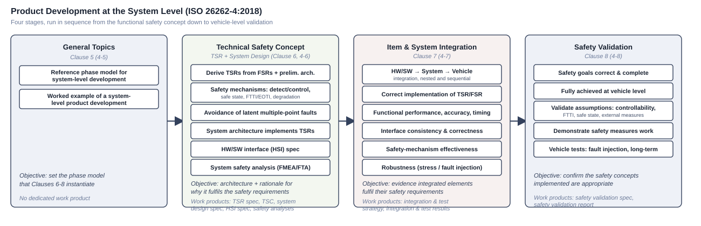

## 4-5 General Topics for Product Development at the System Level (Clause 5)

**Objective** (Clause 5.1): provide an overview of product development at the system level. In an iterative
process the technical safety concept is developed (TSRs + system architectural design); the architecture is
established and TSRs are allocated to system elements (and, if applicable, other technologies); TSRs are
refined and requirements arising from the architecture are added, including the HSI (Clause 5.2). After
hardware and software elements are developed and integrated to form an item, the item is integrated into a
vehicle, and safety validation is performed to provide evidence of functional safety against the safety
goals. Part 4 covers systems; ISO 26262-5 and -6 cover hardware and software development respectively
(Clause 5.2, referencing Figure 2's reference phase model and Figure 3's worked example of a multi-level
system development). Clause 5 has no dedicated work product of its own.

## 4-6 Technical Safety Concept (Clause 6)

**Objectives** (Clause 6.1):

* specify TSRs for the functionality/dependencies/constraints/properties of system elements and
  interfaces;
* specify TSRs for the safety mechanisms to be implemented;
* specify requirements for production, operation, service and decommissioning;
* verify the TSRs are suitable and consistent with the FSRs;
* develop a system architectural design and technical safety concept that satisfy the safety requirements
  without conflicting non-safety requirements;
* analyse the architecture to prevent faults and derive safety-related special characteristics; and
* verify the architecture/technical safety concept satisfy the safety requirements per their ASIL.

**Definition** (Clause 6.2) - the technical safety concept is the aggregation of the TSRs *and* the
  corresponding system architectural design, with the rationale for why that architecture fulfils the safety
  requirements from ISO 26262-3 (considering non-safety requirements and design constraints). TSRs specify
  the *technical implementation* of the FSRs at their hierarchical level, addressing latent-failure
  detection, fault avoidance, safety integrity, and operation/service aspects. The system architectural
  design is the selected system-level solution, aiming to fulfil both the allocated TSRs and the non-safety
  requirements.

**Inputs** (Clause 6.3):
  - prerequisites: the functional safety concept (ISO 26262-3:2018, 7.5.1); the system architectural
    design, from an external source (ISO 26262-3:2018, 7.3.1); and requirements to the item from other
    safety-relevant items, if applicable (e.g. requirements from a park-assist system to a brake system);
  - further supporting information: the HARA report (ISO 26262-3:2018, 6.5.1) and the item definition
    (ISO 26262-3:2018, 5.5.1).
**Specification of TSRs** (Clause 6.4.1):
  - TSRs are specified against the functional safety concept and system architectural design, considering
    (6.4.1.1 a-c): safety-related dependencies/constraints of items, systems and elements; the system's
    external interfaces; and its configurability (design constraints stem from environmental conditions,
    installation space, the implementation itself - performance, thermal capacity/dissipation - and other
    functional/non-functional requirements such as security or physical technology limits, Note 1);
  - TSRs specify the system's stimulus-response behaviour affecting safety-goal achievement, across
    relevant stimuli/failure/operating-mode/system-state combinations (6.4.1.2, e.g. "the brake ECU
    disables ACC braking if a received ACC command fails error-detection-code checks");
  - any other functions/requirements the system implements beyond the ones carrying TSRs must also be
    specified or referenced (6.4.1.3, e.g. ECE/FMVSS rules, platform strategy, a cybersecurity concept);
    and
  - technical safety and non-safety requirements must not contradict each other (6.4.1.4).

**Safety mechanisms** (Clause 6.4.2) - TSRs specify the safety mechanisms that detect faults and
  prevent/mitigate output-level failures violating the FSRs (6.4.2.1), covering (a-e; these are typically
  tied to self-tests at power-up/pre-drive, during operation, power-down/post-drive, and maintenance,
  Note 5):
  - detection/indication/control of faults in the system itself (self-monitoring for random HW faults and,
    where appropriate, systematic faults; includes communication-channel failures - data interfaces,
    buses, wireless links);
  - detection/control of faults in interacting external elements (other ECUs, power supplies, comms
    devices);
  - achieving/maintaining the safe state (including arbitration among multiple safety-mechanism control
    requests);
  - defining/implementing the warning and degradation strategy; and
  - preventing faults from being latent.

  For each safe-state safety mechanism, the TSR specifies (6.4.2.2 a-c, e.g. a brake-by-wire secondary
  power supply/storage spec: capacity, activation time):
  - the state transition (incl. actuator control);
  - the fault handling time interval relative to timing apportioned from the architecture (aiming for
    consistent timing within the FTTI specified per safety goal); and
  - if the safe state can't be reached within the FTTI, the emergency operation tolerance time interval -
    determinable via in-vehicle testing.
  - *Avoidance of latent faults* (6.4.2.3, applies ASIL (A), (B), C, D) - only random HW faults that are
    multiple-point faults can become latent; self-tests verifying component status across operating modes
    (power-up, power-down, during operation, or a dedicated self-test mode - e.g. valve/relay/lamp checks at
    power-up) are the safety mechanism that catches them. Evaluation criteria for whether such a mechanism is
    needed come from good engineering practice, using the latent-fault metric of ISO 26262-5:2018, Clause 8
    (Note 2).
  - *Diagnostic test strategy for multiple-point faults* (6.4.2.4, applies ASIL (A), (B), C, D) - specified
    per safety mechanism, considering (a-d):
    - HW component reliability and its architectural role/contribution to a multiple-point failure;
    - the quantitative target for max. probability of safety-goal violation from random HW failures
      (ISO 26262-5:2018, Clause 9);
    - the ASIL inherited from the safety goal/FSR/higher-level TSR; and
    - the multiple-point fault detection time interval.

    The strategy can be time-driven (e.g. a diagnostic test time interval) or event-driven (e.g. a
    start-up test); a second-order multiple-point failure is two faults separated by the multiple-point
    fault detection time interval (Notes 1-2).
  - *Dual-point-fault-only mechanisms* (6.4.2.5, applies ASIL (A), (B), C, D) - safety mechanisms
    implemented *only* to prevent dual-point faults from being latent shall at least comply with (a-c;
    worked example: a memory's parity check is rated ASIL B, but the requirement for the *self-test
    verifying the parity check itself* can be rated as low as ASIL A):
    - ASIL B, for TSRs assigned ASIL D;
    - ASIL A, for TSRs assigned ASIL B or C; and
    - **QM**, for TSRs assigned ASIL A.

**System architectural design specification and technical safety concept** (Clause 6.4.3):
  - built from the item definition, functional safety concept and prior system architectural design
    (6.4.3.1);
  - its consistency with the architecture from ISO 26262-3:2018, 7.3.1 is checked, iterating Part 3
    activities if discrepancies turn up (6.4.3.2);
  - the architecture must implement the TSRs (6.4.3.3), considering (6.4.3.4 a-c): the ability to verify
    the architecture; the technical capability of the intended HW/SW elements to achieve functional
    safety; and the ability to execute tests during system integration;
  - internal/external interfaces of safety-related elements are defined so other elements can't have
    adverse safety-related effects on them (6.4.3.5); and
  - ASIL decomposition applied during system architectural design follows ISO 26262-9:2018, Clause 5
    (6.4.3.6).

**Safety analyses and avoidance of systematic failures** (Clause 6.4.4) - safety analyses on the
  architecture are performed per Table 1 and ISO 26262-9:2018, Clause 8, to (6.4.4.1):
  - evidence the design's suitability for its ASIL-rated safety functions/properties;
  - identify failure causes and fault effects;
  - identify/confirm safety-related elements and interfaces; and
  - support the design spec while verifying safety-mechanism effectiveness.

**Table 1 - System architectural design analysis (Clause 6.4.4.1)**

  | Method | ASIL A | ASIL B | ASIL C | ASIL D |
  |---|---|---|---|---|
  | Deductive analysis | o | + | ++ | ++ |
  | Inductive analysis | ++ | ++ | ++ | ++ |

  (`o` no recommendation either way, `+` recommended, `++` highly recommended - deductive analysis is
  typified by FTA, inductive by FMEA, per the usual ISO 26262-9:2018, Clause 8 mapping; qualitative analysis
  is sufficient at this stage, Note 2.) Identified internal and external failure causes are eliminated, or
  their effects mitigated, where necessary to comply with the safety goals (6.4.4.2-6.4.4.3). To reduce
  systematic-failure likelihood, well-trusted design principles should be applied where applicable: reuse of
  well-trusted technical safety concepts, element designs (HW and SW), failure detection/control mechanisms,
  and standardized interfaces (6.4.4.4 a-d) - their suitability for the product's application is analysed and
  documented (6.4.4.5). To avoid systematic faults from high complexity, the architecture must exhibit
  modularity, an adequate level of granularity, and simplicity (6.4.4.6 a-c) - achievable via hierarchical
  design, precisely defined interfaces, avoiding unnecessary component/interface complexity, maintainability
  and verifiability (Note; no ASIL-weighted table for these properties is given in Part 4). Hazards newly
  identified during safety analyses or architectural design, not already covered by a safety goal, feed back
  into an updated HARA per ISO 26262-3 (6.4.4.7) - e.g. non-functional hazards outside ISO 26262's scope can
  still be annotated there (Note).

**Measures for control of random hardware failures during operation** (Clause 6.4.5) -
  detection/control/mitigation measures for random HW failures are specified against the architecture
  from 6.4.3 (6.4.5.1, e.g. HW diagnostic features used by SW to detect failures, or a fail-safe HW
  design that always reaches the safe state on a random HW failure without needing detection).
* Applies to ASILs (B), C and D of the safety goal:
  - one of the alternative procedures in ISO 26262-5:2018, Clause 9 is chosen to evaluate safety-goal
    violation from random HW failures, with target values specified for the final item-level evaluation
    (6.4.5.2);
  - target values for failure rate and diagnostic coverage should be specified at the element level per
    ISO 26262-5:2018, Clauses 8-9 (6.4.5.3); and
  - in distributed developments these target values are communicated to each relevant party (6.4.5.4,
    Note 1 - Part 5's architectural-constraint clauses don't necessarily apply to COTS parts, where
    suppliers instead provide base data such as failure rate/mode/distribution and built-in diagnostics).

**Allocation to hardware and software** (Clause 6.4.6) - TSRs are allocated to system architectural design
  elements with system, hardware or software as the implementing technology (6.4.6.1; if allocated to
  "system", Part 4 is applied again iteratively until it reaches hardware/software, Note). Allocation and
  partitioning decisions must comply with the architecture (6.4.6.2, which can partition functions/components
  to achieve independence and avoid failure propagation, Note). Each architectural element inherits the
  *highest* ASIL among the TSRs it implements (6.4.6.3); an element mixing different ASILs, or safety- and
  non-safety-related sub-elements, is treated at the highest ASIL unless ISO 26262-9:2018, Clause 6
  coexistence criteria are met (6.4.6.4). TSRs allocated to custom programmable hardware (ASICs, FPGAs, other
  digital HW) need an adequate development process combining ISO 26262-5 and -6 requirements (6.4.6.5; some
  such elements can instead use the ISO 26262-8:2018, Clause 13 hardware-evaluation route, Note 1).

**Hardware-software interface (HSI) specification** (Clause 6.4.7) - specifies the HW/SW interaction,
  consistent with the technical safety concept, and includes the HW parts controlled by software plus HW
  resources supporting software execution (6.4.7.1; example content is in Annex B). Must include
  (6.4.7.2 a-e):
  - relevant operating modes (default, initialization, test, advanced, ...) and configuration parameters
    (gain control, band-pass frequency, clock prescaler);
  - HW features ensuring element independence or supporting SW partitioning;
  - shared/exclusive use of HW resources (memory mapping, register/timer/interrupt/I/O-port allocation);
  - the access mechanism to HW devices (serial, parallel, slave, master/slave); and
  - timing constraints derived from the technical safety concept.

  Relevant HW diagnostic capabilities and their SW usage are specified: the HW diagnostic features
  themselves (e.g. overcurrent, short-circuit, over-temperature detection), and which of those diagnostics
  are implemented in software (6.4.7.3 a-b). The HSI is specified during system architectural design and
  later refined during HW development (ISO 26262-5:2018, Clause 6) and SW development (ISO 26262-6:2018,
  Clause 6) (6.4.7.4).

**Production, operation, service and decommissioning** (Clause 6.4.8) - the ISO 26262-7:2018 requirements
  identified during system architectural design are specified (6.4.8.1 a-f, e.g. assembly/disassembly
  instructions, repair permissions, labelling):
  - measures to achieve/maintain/restore safety-related functions and properties during production,
    service or decommissioning;
  - safety-related special characteristics;
  - requirements ensuring proper system/element identification;
  - production verification measures;
  - service requirements (diagnostic data, service notes); and
  - decommissioning measures.

  Diagnostic features are specified to provide field-monitoring data per ISO 26262-2:2018, Clause 7,
  considering the safety analyses results and implemented safety mechanisms (6.4.8.2); and to allow fault
  identification plus checking the effectiveness of maintenance/repair during servicing (6.4.8.3).

**Verification** (Clause 6.4.9) - TSRs are verified per ISO 26262-8:2018, Clauses 6 and 9, for
  correctness, completeness and consistency against the system's boundary conditions (6.4.9.1). The system
  architectural design, HSI spec, production/operation/service/decommissioning requirements and the
  technical safety concept are verified per Table 2, to evidence (6.4.9.2 a-c):
  - suitability/adequacy for the required functional safety level per ASIL;
  - consistency between the architecture and the technical safety concept; and
  - validity of/compliance with prior development steps' architectures.

**Table 2 - Verification (Clause 6.4.9.2)**

  | Method | ASIL A | ASIL B | ASIL C | ASIL D |
  |---|---|---|---|---|
  | Inspection | + | ++ | ++ | ++ |
  | Walkthrough | ++ | + | o | o |
  | Simulation | + | + | ++ | ++ |
  | System prototyping and vehicle tests | + | + | ++ | ++ |
  | System architectural design analyses | see Table 1 | | | |

  (Inspection/walkthrough check complete and correct implementation of the requirements; simulation/prototyping
  can double as a fault-injection test supporting a completeness/correctness argument, Notes a-b.)

**Work products** (Clause 6.5):

* Technical safety requirements specification (6.5.1, from 6.4.1-6.4.2)
* Technical safety concept (6.5.2, from 6.4.3-6.4.6)
* System architectural design specification (6.5.3, from 6.4.3-6.4.6)
* HSI specification (6.5.4, from 6.4.7)
* Specification of requirements for production/operation/service/decommissioning (6.5.5, from 6.4.8)
* Verification report, covering the architecture, HSI spec, production/operation/service/decommissioning
  requirements and the technical safety concept (6.5.6, from 6.4.9)
* Safety analyses report (6.5.7, from 6.4.4)

## 4-7 System and Item Integration and Testing (Clause 7)

**Objectives** (Clause 7.1): the integration/testing phase has three sub-phases - hardware-software integration,
system integration (assembling a complete item), and vehicle integration - aimed at (a-c):

* defining the integration steps and integrating system elements until fully integrated;
* verifying the safety measures from the architectural-level safety analyses are properly implemented; and
* evidencing that integrated elements fulfil their safety requirements per the system architectural
  design.

**General** (Clause 7.2) - integration proceeds systematically from HW/SW integration+verification, through
system integration+verification, to vehicle integration+verification, with specified integration tests at
each stage evidencing correct interaction. System integration starts once HW/SW development per ISO 26262-5/-6
is sufficiently advanced.

**Inputs** (Clause 7.3):
  - prerequisites: safety goals (ISO 26262-3:2018, 6.5.1); functional safety concept (ISO 26262-3:2018,
    7.5.1); technical safety concept (6.5.2); system architectural design specification (6.5.3); and the
    HSI specification (6.5.4, plus ISO 26262-5:2018, 6.5.2 and ISO 26262-6:2018, 6.5.2);
  - further supporting information: vehicle architecture and other vehicle systems' technical safety
    concepts (both external sources), and the safety analyses report (6.5.7).

**Specification of integration and test strategy** (Clause 7.4.1) - integration testing (per
ISO 26262-8:2018, Clause 9) checks (7.4.1.1 a-d):
  - correct implementation of FSRs/TSRs;
  - correct functional performance, accuracy and timing of safety mechanisms;
  - consistent and correct interface implementation; and
  - adequate robustness.

  An integration and test strategy is defined against the system architectural design, functional safety
  concept and technical safety concept, addressing test goals suitable for evidencing functional safety and
  the integration/testing of contributing elements - including elements of other technologies (7.4.1.2). To
  enable item integration, the strategy (7.4.1.3 a-d):
  - covers HW/SW integration and testing;
  - specifies system- and vehicle-level integration tests and ensures open HW/SW-verification issues are
    addressed;
  - considers interfaces between vehicle systems (internal/external to the item) and the environment; and
  - considers whether any integrated systems/elements are a Safety Element out of Context (SEooC) whose
    development-time assumptions need verifying.

  If the system is configurable, verification at system/vehicle level must evidence compliance for the
  series-production configurations (a justified subset may suffice) (7.4.1.4). Each FSR and TSR is verified
  (by testing, if applicable) at least once in the complete integration sub-phase (7.4.1.5, Notes 1-3):
  - common practice verifies a requirement at the next integration level above where it was specified;
  - a SEooC's development-time assumptions are also verified on integration; and
  - safety anomalies are reported per ISO 26262-2:2018, 5.4.3.

  Test cases for integration testing are derived using an
  appropriate combination of methods from Table 3 (analysis of requirements; of external/internal interfaces;
  equivalence-class generation for HW/SW integration; boundary-value analysis; error guessing; analysis of
  functional dependencies; analysis of common limit conditions/sequences/dependent-failure sources per
  ISO 26262-9:2018, Clause 7; analysis of environmental conditions/use cases; and analysis of field experience),
  considering the integration level (7.4.1.6).
**Hardware-software integration and testing** (Clause 7.4.2) - HW developed per ISO 26262-5 and SW developed
per ISO 26262-6 are integrated and tested for compliance with the HSI specification; production-intent HW/SW
is preferred, with modified HW/SW used only where a specific test technique needs it (7.4.2.1.1-7.4.2.1.2).

**System integration and testing** (Clause 7.4.3) - the system's individual elements are integrated per the
system architectural design and tested per the system integration test specification, evidencing correct
interaction, compliance with technical/functional safety requirements, and adequate confidence that
safety-goal-violating unintended behaviour is absent (7.4.3.1.1).

**Vehicle integration and testing** (Clause 7.4.4) - the item is integrated into the vehicle and vehicle
integration tests are carried out (7.4.4.1.1); the item's interface with the in-vehicle communication network
and power-supply network is verified (7.4.4.1.2).

**Test objectives across the three integration levels** - at each level, test goals are addressed via
appropriate methods from the corresponding tables:

  | Test objective | HW/SW level | System level | Vehicle level |
  |---|---|---|---|
  | Correct implementation of FSRs/TSRs | Table 4 (7.4.2.2.2) | Table 9 (7.4.3.2.2) | Table 13 (7.4.4.2.2) |
  | Functional performance, accuracy, timing of safety mechanisms | Table 5 (7.4.2.2.3) | Table 10 (7.4.3.2.3) | Table 14 (7.4.4.2.3) |
  | Consistent/correct interfaces | Table 6 (7.4.2.2.4) | Table 11 (7.4.3.2.4) | Table 15 (7.4.4.2.4) |
  | Effectiveness of HW fault-detection mechanisms | Table 7 (7.4.2.2.5) | - (folded into Table 10) | - (folded into Table 14) |
  | Level of robustness | Table 8 (7.4.2.2.6) | Table 12 (7.4.3.2.5) | Table 16 (7.4.4.2.5) |

  Recurring methods across these tables: requirements-based tests, fault injection tests, back-to-back tests
  (vs. a simulation model), performance tests, error-guessing tests, interface/interaction tests, resource-usage
  tests, stress tests, and - at system/vehicle level only - tests derived from field experience, long-term
  tests, and user tests under real-life conditions (the last three trading specified test scenarios for larger
  samples, normal-user testers and everyday conditions, with limitations for tester safety where needed).

**Work products** (Clause 7.5):

* Integration and test strategy (7.5.1, from 7.4.1)
* Integration and test report (7.5.2, from 7.4.2-7.4.4)

## 4-8 Safety Validation (Clause 8)

**Objectives** (Clause 8.1): provide evidence that the safety goals are achieved by the item once integrated into
the vehicle(s); and provide evidence that the functional safety concept and technical safety concept are
appropriate for achieving the item's functional safety. Part 4 does not state an ASIL floor for this clause
(per the Clause 4.4 default rule, its requirements apply across ASIL A-D unless stated otherwise, and no such
statement appears in Clause 8).

**General** (Clause 8.2) - prior verification activities (design verification, safety analyses, HW/SW/item
integration and test) each evidence compliance with their own specified requirements; safety validation of
the integrated item in representative vehicle(s) instead evidences appropriateness for intended use and
confirms the adequacy of safety measures for a class/set of vehicles, based on examination and test.

**Inputs** (Clause 8.3):
  - prerequisites: the HARA report (ISO 26262-3:2018, 6.5.1) and the functional safety concept
    (ISO 26262-3:2018, 7.5.1);
  - further supporting information: the technical safety concept (6.5.2), item definition
    (ISO 26262-3:2018, 5.5.1), and safety analyses report (6.5.7).

**Safety validation environment** (Clause 8.4.1) - safety goals are validated for the item in a representative
vehicle-level context, covering (where applicable) system, software, hardware, elements of other
technologies and external measures (8.4.1.1; especially relevant for T&B, where different base-vehicle types
may need validating, Note 2). Representative vehicles are chosen by vehicle type and configuration, informed
by the HARA report (8.4.1.2). Safety goals are validated considering operational variance affecting the
technical characteristics already considered in the HARA (8.4.1.3).

**Specification of safety validation** (Clause 8.4.2) - defines (8.4.2.1 a-c):
  - the validated item's configuration, including calibration data per ISO 26262-6:2018, Annex C (a
    reasonable subset may substitute for full per-configuration validation, Note);
  - safety validation procedures, test cases, driving manoeuvres and acceptance criteria; and
  - the equipment/environmental conditions needed.

**Execution of safety validation** (Clause 8.4.3) - if testing is used, the ISO 26262-8:2018, 9.4.2-9.4.3
  verification-testing requirements may apply (8.4.3.1). Achievement of functional safety in the integrated
  vehicle is validated by evaluating (8.4.3.2 a-d, e.g. validating a mechanical component assumed to
  mitigate a hazard from an E/E-system malfunction):
  - controllability (via intended-use and foreseeable-misuse scenarios - sufficient controllability in the
    safe state per ISO 26262-3:2018, 7.4.2.5 is one acceptance criterion);
  - effectiveness of external measures;
  - effectiveness of elements of other technologies; and
  - HARA assumptions (ISO 26262-3:2018, 6.4.4.4) that can only be checked in the final vehicle.

  Validation is executed per the safety validation procedures/test cases (with pass/fail criteria per
  safety goal) and the defined scope of application - configuration, environmental conditions, driving
  situations, operational use cases (8.4.3.3 a-b). An appropriate set of methods is applied (8.4.3.4 a-e):
  - repeatable tests with specified procedures/pass-fail criteria (e.g. positive/black-box tests,
    simulation, boundary-condition tests, fault injection, durability/stress tests, HALT, simulated
    external influences);
  - analyses (FMEA, FTA, ETA, simulation);
  - long-term tests (vehicle driving schedules, captured test fleets);
  - operational use cases under real-life conditions, panel/blind tests or expert panels; and
  - reviews.

**Evaluation** (Clause 8.4.4) - safety validation results are evaluated to evidence that the implemented
safety goals achieve functional safety for the item (8.4.4.1).

**Work products** (Clause 8.5):

* Safety validation specification, including the safety validation environment description (8.5.1, from
  8.4.1-8.4.2)
* Safety validation report (8.5.2, from 8.4.3-8.4.4)

# ISO 26262-5 - Product Development at Hardware Level

Part 5 turns the hardware-allocated technical safety requirements (TSRs, ISO 26262-4:2018, Clause 6)
into a qualified, quantitatively evaluated hardware design. It runs as six clauses:

* **Clause 5** General topics for the product development at the hardware level
* **Clause 6** Specification of the hardware safety requirements
* **Clause 7** Hardware design
* **Clause 8** Evaluation of the hardware architectural metrics
* **Clause 9** Evaluation of safety goal violations due to random hardware failures
* **Clause 10** Hardware integration and verification

Uniquely among Parts 4-6, Part 5 contains two dedicated clauses (8 and 9) for *quantitative* evaluation
of the overall hardware architecture - software has no equivalent. These notes label them
"5-5"..."5-10" (Part-Clause):

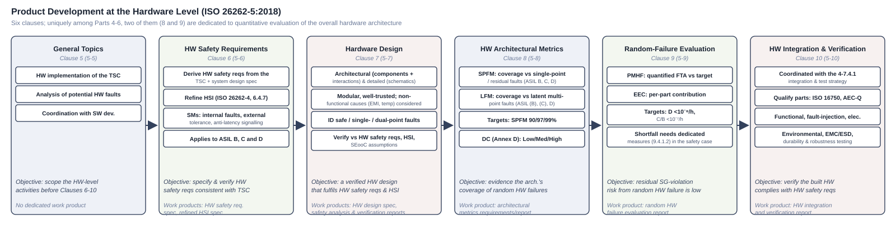

## 5-5 General Topics for the Product Development at the Hardware Level (Clause 5)

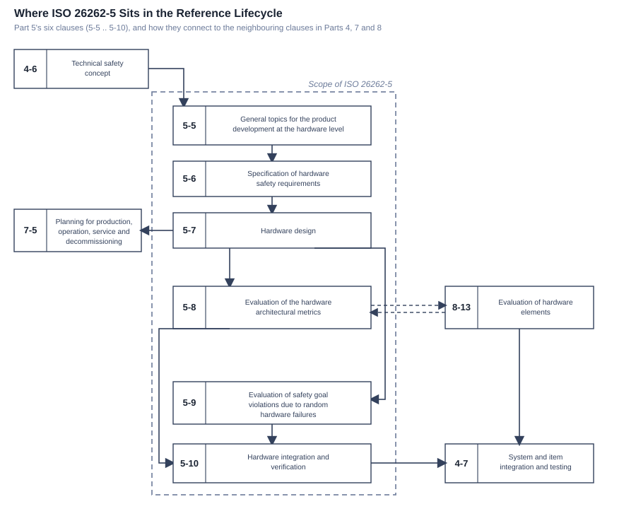

The necessary activities/processes at the hardware level are:

* the hardware implementation of the technical safety concept;
* analysis of potential hardware faults and their effects; and
* coordination with software development.

Clause 5 has no dedicated work product of its own - it exists to frame Clauses 6-10. Part 5 sits between:

* the technical safety concept (ISO 26262-4:2018, 4-6), feeding **in**; and, downstream,
* the production/operation/service/decommissioning planning (ISO 26262-7:2018, 7-5), fed from hardware design (5-7);
* system/item integration and testing (ISO 26262-4:2018, 4-7), fed from hardware integration and verification (5-10); and
* the hardware-element evaluation route of ISO 26262-8:2018, Clause 8-13, which interacts with the hardware architectural metrics and random-hardware-failure evaluation clauses (5-8, 5-9) for elements not otherwise developed to ISO 26262.

## 5-6 Specification of the Hardware Safety Requirements (Clause 6)

**Objectives**:

* specify the hardware safety requirements, derived from the technical safety concept and the system
  architectural design specification;
* refine the hardware-software interface (HSI) specification initiated in ISO 26262-4:2018, 6.4.7; and
* verify that both are consistent with the technical safety concept and the system architectural design
  specification.

**Four categories of hardware safety requirement**, each with the attributes needed to ensure the
  corresponding safety mechanism's effectiveness (e.g. the fault reaction time of the hardware part of a
  safety mechanism, kept consistent with the fault tolerant time interval):
  1. Safety mechanisms controlling **internal** failures of the element's hardware - e.g. the timing and
     detection ability of a watchdog.
  2. Safety mechanisms making the element tolerant to failures **external** to it - e.g. the functional
     behaviour required of an ECU on an open-circuit input.
  3. Safety mechanisms that comply with the safety requirements **of other elements** - e.g. diagnosis
     of sensors or actuators.
  4. Safety mechanisms that **detect and signal** internal or external failures, preventing them from
     staying latent.
* Hardware safety requirements carry both target values (from the requirements themselves) and
  avoidance-of-specific-behaviour requirements with an ASIL attached - e.g. "this sensor shall not
  produce a wrong output," ASIL-tagged. All four categories apply to ASIL B, C and D.
* Qualification/testing of the item's hardware must cover:
  - environmental conditions (temperature, vibration, EMC, ...);
  - the specific operational environment; and
  - component-specific requirements.
* Hardware safety requirements must ensure compliance with:
  - the fault tolerant time interval for safety mechanisms; and
  - the multiple-point fault detection interval - for ASIL C/D safety goals whose safety concept doesn't
    prescribe a specific value, this can default to the item's power-up-to-power-down cycle, or be
    justified by a quantitative analysis of random hardware failure occurrence.

**Verification** - hardware safety requirements must demonstrate:
  - consistency with the technical safety concept, system design specification and hardware
    specification;
  - completeness with respect to the TSRs allocated to the hardware elements under consideration; and
  - correctness/accuracy - via walkthrough and inspection of the hardware safety requirements.

**HSI specification**:
  - the HSI initiated during system design is detailed down to a level that lets software control and use
    it correctly; and
  - hardware and software developers jointly verify the adequacy of the refined HSI specification.

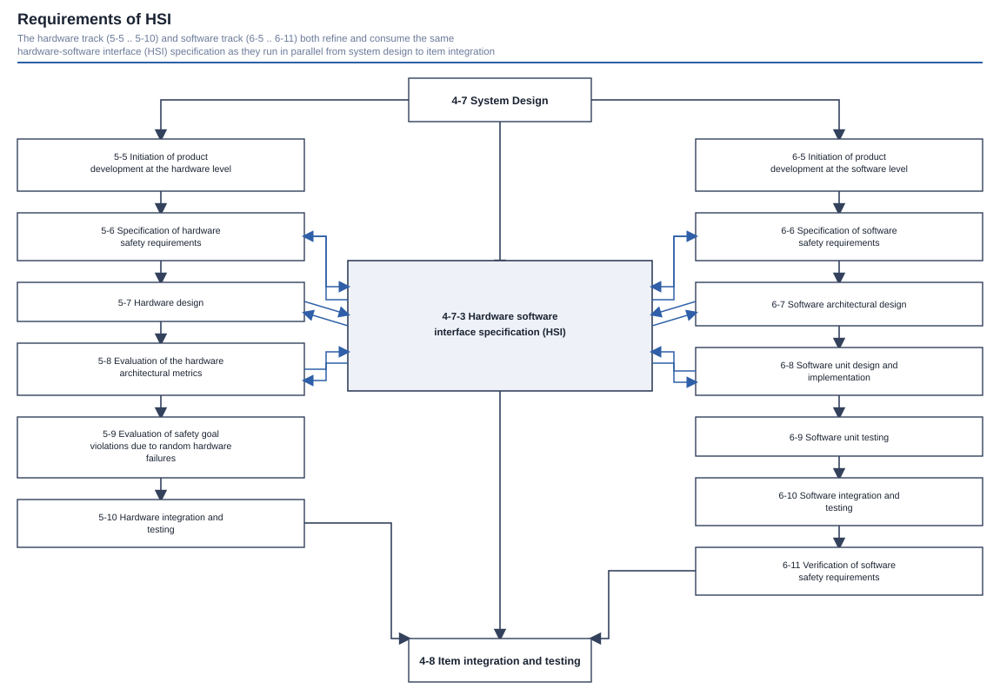

## 5-7 Hardware Design (Clause 7)

**Objectives**:

* (a) create a hardware design that:
  - supports and considers the results of the safety-oriented analyses;
  - fulfils the hardware safety requirements and the HSI specification;
  - is consistent with the system architectural design specification; and
  - satisfies the required hardware design properties;
* (b) specify requirements/information regarding functional safety of the hardware during production,
  operation, service and decommissioning; and
* (c) verify:
  - that the design can fulfil the hardware safety requirements and HSI specification;
  - the validity of the assumptions used to develop any SEooC integrated in the hardware; and
  - the suitability of the safety-related special characteristics to achieve functional safety during
    production and service.

* Hardware design splits into **hardware architectural design** (all hardware components and their
  interactions) and **hardware detailed design** (electrical schematics representing the interconnections
  between the parts making up each component).
**Architectural design requirements**:
  - A hardware element inherits the ASIL from the hardware safety requirements; traceability between
    safety requirements and their implementation is maintained down to hardware components, but
    *not* down to hardware detailed design - no ASILs are assigned to hardware parts at that level.
  - Modular design to avoid failures: hierarchical design, precisely defined interfaces of safety-related
    hardware components, avoidance of unnecessary interface/component complexity, maintainability,
    testability.
  - Well-trusted components help avoid unknown/first-time failures, without discouraging new
    technology as long as its safety properties are adequately analysed. Non-functional causes -
    temperature, vibration, dust, EMI, cross-talk, whether from within the component or from other
    hardware components in the architecture - that could contribute to a safety-related component's
    failure must be considered.

**Detailed design requirements**:
  - use lessons learned from known/previous designs to avoid common faults;
  - consider non-functional causes of failure;
  - keep components within their operational and environmental specification limits;
  - apply robust design principles; and
  - consider the mission profile and operating conditions so each hardware part/component is operated
    within its specification, avoiding failures due to its intended use.

**Safety analysis as part of design** - deductive and inductive analysis determine the effects and
  causes of faults, first supporting the architectural/detailed design specification and later reused for
  design verification; qualitative analysis can be sufficient at this stage (an FMEA at component level can
  supply the basic events for an FTA conducted at a higher abstraction level):

  | Method | ASIL A | ASIL B | ASIL C | ASIL D |
  |---|---|---|---|---|
  | Deductive analysis | o | + | ++ | ++ |
  | Inductive analysis | ++ | ++ | ++ | ++ |

**Fault identification for ASIL B/C/D safety goals** - for each safety-related hardware element: 
  * safe faults 
  * single-point faults or residual faults; 
  * and dual-point faults (perceived, detected or latent).
    * Multiple-point faults of order higher than 2 are considered only if the safety concept shows them as relevant. 
    * The intent is not an exhaustive combinatorial analysis of every two-fault combination, but deriving the relevant combinations from the safety concept - e.g. one fault hitting a safety-related element and an independent second fault hitting the safety mechanism meant to achieve/maintain the safe state for it.

**Evidence required from the design** - effectiveness of the safety mechanisms should provide show that it 
  - avoid single-point faults;
  - prevent multiple-point faults from staying latent
  - achieve/maintain a safe state (or switch safely into one) - in particular, adequate failure mitigation
    within the fault tolerant time interval and the maximum fault handling time interval   
  - provide diagnostic coverage which residual faults evaluated; 
  - FMEA or FTA can provide the rationale 
  - where independence requirements should show dependent failure analysis.

**Verification of the hardware design** (per ISO 26262-8:2018, Clause 9) evidences that it 
  - fulfils the hardware safety requirements
  - is compatible with the HSI specification
  - that its safety-related special characteristics are suitable for production and service:

  | Method | ASIL A | ASIL B | ASIL C | ASIL D |
  |---|---|---|---|---|
  | Hardware design walk-through | ++ | ++ | o | o |
  | Hardware design inspection | + | + | ++ | ++ |
  | Safety analyses | (per the table above) | | | |
  | Simulation | o | + | + | + |
  | Development by hardware prototyping | o | + | + | + |

  Walk-through/inspection check complete and correct implementation of the hardware safety
  requirements; simulation/prototyping check specific points the analytical methods aren't sufficient
  for - e.g. fault injection as described in ISO 26262-11:2018, 4.8.

**Production and operation**:
  - safety-related special characteristics (e.g. temperature range for a specific process, material
    characteristics, expiration date, fastening torque, production tolerance, configuration) are specified
    where safety analyses show them relevant, each carrying verification measures and acceptance
    criteria;
  - assembly/disassembly/decommissioning instructions for safety-related hardware elements are issued
    where those operations could impact the safety concept;
  - traceability of safety-related hardware elements is ensured (e.g. labelling); and
  - maintenance instructions are issued where maintenance could impact the safety concept.
  * **Quantitative requirements for the HW Design** - Clauses 8 and 9 both gate off the hardware design
    as combined, quantitative follow-on checks: Clause 8 evaluates the architectural metrics (SPFM/LFM),
    and Clause 9 evaluates safety-goal violation via *either* the PMHF or the EEC/SG method (at least one
    of the two, hence the "≥1" gate):

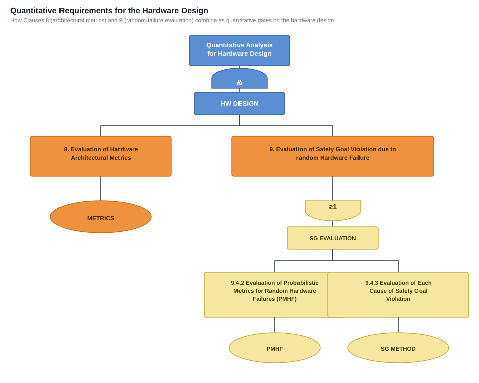

## 5-8 Evaluation of the Hardware Architectural Metrics (Clause 8)

**Purpose**: provide evidence, via hardware architectural metrics, that the hardware architectural design is
suitable for detecting and controlling safety-related random hardware failures. The metrics are meant to:

* be objectively assessable - a comprehensible way to differentiate architectures;
* support evaluation of the final, detailed design;
* supply ASIL-dependent pass/fail criteria;
* reveal whether safety-mechanism coverage of single-point/residual faults is sufficient (the
  **single-point fault metric**, SPFM);
* reveal whether coverage of latent faults is sufficient (the **latent-fault metric**, LFM);
* address single-point, residual and latent faults;
* stay robust to uncertainty in hardware failure rates;
* stay limited to safety-related elements; and
* support use at different element levels (e.g. assigning target values to a supplier's hardware
  elements).

SPFM applies to ASIL (B), C and D of the safety goal; LFM likewise applies to ASIL (B), (C) and D.

**Failure rate data** comes from either a recognised industry source for part failure rates and failure
mode distributions (e.g. SN 29500, IEC 61709, MIL-HDBK-217F Notice 2, RIAC HDBK-217Plus,
UTE C80-811, NPRD-2016, EN 50129:2003 Annex C, RIAC FMD-2016, MIL-HDBK-338, FIDES 2009
EdA), considering the mission profile, applicability of the failure modes to the operating conditions, and
the failure rate unit (per operating hour or per calendar hour); or from expert judgement, exercised
against structured criteria fixed *before* the failure-rate estimation is made.

**Failure classification flow**, per hardware element and per failure mode:
  - a non-safety-related element's faults are excluded from the analysis entirely;
  - for a safety-related element's failure mode, ask whether it could violate a safety goal with no safety
    mechanism in place - if not, it's a **safe fault** (λ_S);
  - if it could, ask whether any safety mechanism controls that failure mode:
    - none in place -> a **single-point fault** (λ_SPF);
    - a mechanism with partial coverage -> the uncovered portion becomes a **residual fault** (λ_RF);
  - for a fault that could only violate the safety goal in combination with one other independent fault,
    ask whether a mechanism (or driver perception) keeps it from staying latent:
    - covered -> **multiple-point fault, detected/perceived** (λ_MPF,DP);
    - not (fully) covered -> **multiple-point fault, latent** (λ_MPF,L).

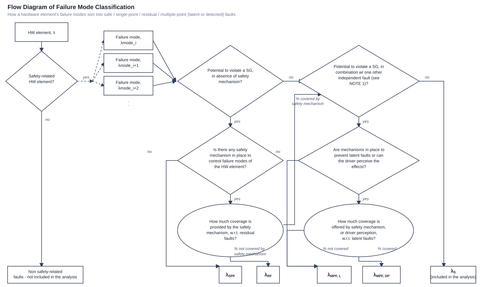

  λ = λ_S + λ_SPF + λ_RF + λ_MPF, and λ_MPF = λ_MPF,DP + λ_MPF,L.

  λ_RF = λ x (1 - DC_(w.r.t. residual faults) / 100); λ_MPF,L = λ x (1 - DC_(w.r.t. latent multiple-point faults) / 100).
  This calculation is carried out per safety-related component, for each of its failure modes.

**Metric formulas** (summed over the safety-related hardware, SR,HW):

  SPFM = 1 - Σ(λ_SPF + λ_RF) / Σλ = Σ(λ_MPF + λ_S) / Σλ

  LFM = 1 - Σ(λ_MPF,L) / Σ(λ - λ_SPF - λ_RF) = Σ(λ_MPF,DP + λ_S) / Σ(λ - λ_SPF - λ_RF)

**Target values**:

  | | ASIL B | ASIL C | ASIL D |
  |---|---|---|---|
  | Single-point fault metric | >=90% | >=97% | >=99% |
  | Latent-fault metric | >=60% | >=80% | >=90% |

  For each safety goal, numeric SPFM/LFM targets are sourced either from metric calculations on similar
  well-trusted designs, or as given directly by the standard.

  - Where an item mixes hardware element kinds with significantly different failure-rate magnitudes,
    compliance can focus on the kind with the highest failure rates - e.g. single-point fault metric
    compliance demonstrated from wire/fuse/connector failure rates alone, disregarding parts with a much
    lower failure rate.
  - If a target isn't met, the safety case must carry a rationale (which can be a state-of-the-art
    argument) for how the safety goal is still achieved.
### What Diagnostic Coverage (DC) Is

* Measures how much of a hardware element's dangerous fault space a safety mechanism actually catches.
* It's a percentage: of all the failure-rate mass (λ) that could violate a safety goal, DC is the
  fraction a given diagnostic/safety mechanism detects and controls.
* Higher DC directly correlates with a lower effective failure rate.
* ISO 26262-5 Annex D gives pre-baked bands per element type (power supplies, harnesses, sensors, etc.).

**Determining diagnostic coverage (DC)** - DC categories are Low (60%), Medium (90%) and High
(99%), per ISO 26262-5 Annex D, which tabulates the failure modes a safety mechanism must cover to
claim each DC level, per element/mechanism type:
  - Example (Table D.7, power supply): input voltage/current monitoring achieves only Low DC, while
    output voltage/current monitoring achieves High DC.
  - The coverage claims compound as the DC level rises - e.g. for harnesses/splices/connectors
    (Table D.3): Low DC needs open-circuit and short-to-ground detection; Medium DC adds
    short-to-Vbat and short-between-neighbouring-pins; High DC adds contact resistance and resistive
    drift between pins.

## 5-9 Evaluation of Safety Goal Violations Due to Random Hardware Failures (Clause 9)

**Purpose**: provide evidence that the residual risk of a safety goal violation, due to the item's random
hardware failures, is sufficiently low - "sufficiently low" meaning comparable to accepted risk on similar
items already in use.

**Two alternative methods**, both evaluating the residual risk of violating a safety goal from single-point
faults, residual faults and plausible dual-point faults (accounting for safety-mechanism coverage and
the exposure duration of a dual-point fault). Scope is limited to the item's random hardware failures -
electrical and electronic hardware parts are considered in full; for electromechanical hardware parts,
only the electrical failure modes and failure rates are considered.
  1. **PMHF (Probabilistic Metric for random Hardware Failures)** - quantify the safety goal's violation
     probability, e.g. via a quantified FTA, and compare the result against a target value.
  2. **EEC (Evaluation of Each Cause of safety goal violation)** - individually evaluate each hardware
     part's contribution to the safety goal violation, with respect to residual, single-point and plausible
     dual-point failures.

**Target values** (random hardware failure target; tailorable per Clause 4.2 for items whose intended
use differs from a typical passenger car, e.g. a longer exposure duration):

  | ASIL | Random hardware failure target values |
  |---|---|
  | D | <10⁻⁸ h⁻¹ |
  | C | <10⁻⁷ h⁻¹ |
  | B | <10⁻⁷ h⁻¹ |

**EEC method mechanics**:
  - evaluate the single-point/residual failure rate of the critical hardware component responsible for the
    safety goal violation, and compare it against the standard's target tables - since the residual-failure
    target already accounts for diagnostic coverage, a higher DC allows a higher (less strict) target
    failure rate;
  - the single-point/residual failure rates already computed for the SPFM/LFM analysis (Clause 8) can be
    reused directly, expressed per hour; and
  - if a fault evaluation fails the combined occurrence-and-coverage criterion, its corresponding
    dual-point failure is then evaluated against a separate occurrence criterion.

**Failure Rate Classes (FRC)** - analogous to the occurrence ratings used in FMEA (1 = lowest
occurrence), calibrated off the ASIL D target divided by 100:

  | FRC | Target value | Remarks |
  |---|---|---|
  | FRC-1 | 10⁻¹⁰ /h | ASIL D failure target divided by 100 |
  | FRC-2 | 10⁻⁹ /h | Ten times the FRC-1 value |
  | FRC-3 | 10⁻⁸ /h | 100 times the FRC-1 value |
  | FRC-4 | 10⁻⁷ /h | For i > 3, FRC-i <= 10^(i-1) x the FRC-1 value |
  | FRC-5 | 10⁻⁶ /h | |

  Target FRC by ASIL and the residual fault's diagnostic coverage:

  | ASIL | DC >=99.9% | DC >=99% | DC >=90% | DC <90% |
  |---|---|---|---|---|
  | D | FRC-4 (10⁻⁷/h) | FRC-3 (10⁻⁸/h) | FRC-2 (10⁻⁹/h) | FRC-1 (10⁻¹⁰/h) + dedicated measures |
  | C | FRC-5 (10⁻⁶/h) | FRC-4 (10⁻⁷/h) | FRC-3 (10⁻⁸/h) | FRC-2 (10⁻⁹/h) + dedicated measures |
  | B | FRC-5 | FRC-4 | FRC-3 | - |

**Dedicated measures** (referenced against the standard's 9.4.1.2, used to justify a component whose
achieved failure rate falls short at low DC):
  - design features such as hardware part over-design (e.g. electrical or thermal stress rating) or
    physical separation (e.g. contact spacing on a PCB);
  - a special sample test of incoming material targeting that failure mode;
  - a burn-in test;
  - a dedicated control set as part of the control plan; and
  - assignment of safety-related special characteristics.

## 5-10 Hardware Integration and Verification (Clause 10)

**Purpose**: ensure, by verification, the compliance of the developed hardware with the hardware safety
requirements.

* Hardware integration and verification activities are performed per ISO 26262-8:2018, Clause 9, and
  coordinated with the integration and test strategy specified in ISO 26262-4:2018, 7.4.1. If ASIL
  decomposition (ISO 26262-9:2018, Clause 5) was applied, the decomposed elements' integration
  activities - and everything downstream of them - are carried out at the ASIL that existed *before*
  decomposition.
* Safety-related hardware parts are qualified per well-established procedures based on worldwide
  quality standards or equivalent company standards - e.g. ISO 16750, or AEC-Q100/AEC-Q200 for
  electronic parts.
**Test-case derivation methods** (ASIL-weighted, the same style of table as ISO 26262-4:2018's
integration-testing table):
  - analysis of requirements;
  - analysis of internal/external interfaces;
  - generation and analysis of equivalence classes;
  - analysis of boundary values;
  - knowledge/experience-based error guessing;
  - analysis of functional dependencies;
  - analysis of common limit conditions/sequences/sources of dependent failures;
  - analysis of environmental conditions and operational use cases;
  - applicable standards; and
  - analysis of significant variants.

**Tests verifying completeness/correctness of safety-mechanism implementation**:
  - *Functional testing* - verify the item's specified characteristics using input data that characterises
    expected normal operation; compare observed outputs against the specification and analyse any
    anomalies or indications of an incomplete specification.
  - *Fault injection testing* - per ISO 26262-11:2018, 4.8, for semiconductor components.
  - *Electrical testing* - compliance with the hardware safety requirements across the specified static
    and dynamic voltage range; ISO 16750 and ISO 11452 can apply.

**Tests verifying durability, robustness and operation under stress**:
  - environmental testing with basic functional verification (ISO 16750-4);
  - expanded functional testing (rare or out-of-specification input conditions, e.g. extreme
    mission-profile values or an incorrect command);
  - statistical testing (input drawn from the real mission profile's statistical distribution, pass/fail
    defined against the required failure rate);
  - worst-case testing (environmental conditions pushed to their specified marginal values);
  - over-limit testing (conditions increased past specification until the element fails, to determine its
    robustness margin);
  - mechanical testing (e.g. tensile strength, ISO 16750-3);
  - accelerated life testing (predicting lifetime behaviour via a failure-mode-acceleration model under
    higher-than-operational stress);
  - mechanical endurance testing (mean time to failure or maximum cycle count, tested to failure or by
    damage evaluation);
  - EMC/ESD testing (ISO 7637-2/-3 and ISO 11452-2/-4 for EMC, ISO 10605 for ESD); and
  - chemical testing (ISO 16750-5).

## Work Products (Clauses 5-10)

* Hardware safety requirement specification (including test and qualification criteria)
* Hardware architectural metrics requirements
* Random hardware failure requirements
* Hardware-software interface specification
* Hardware safety requirements verification report
* Hardware design specification
* Hardware safety analysis report
* Hardware design verification report
* Requirements for production and operation
* Hardware integration and verification report

# ISO 26262-6 - Product Development at the Software Level

Part 6 turns the technical safety requirements allocated to software (ISO 26262-4:2018, Clause 6) and the
hardware-software interface (HSI) into a qualified, verified embedded software product. It runs as seven
clauses:

* **Clause 5** General topics for the product development at the software level
* **Clause 6** Specification of the software safety requirements
* **Clause 7** Software architectural design
* **Clause 8** Software unit design and implementation
* **Clause 9** Software unit verification
* **Clause 10** Software integration and verification
* **Clause 11** Verification of software safety requirements

Unlike Part 5, no clause here is dedicated to quantitative evaluation - software failures are treated as
systematic rather than randomly quantifiable, so the whole part is oriented around process rigor (design
principles, coverage metrics, verification methods) rather than failure-rate arithmetic. These notes label
them "6-5".."6-11" (Part-Clause):

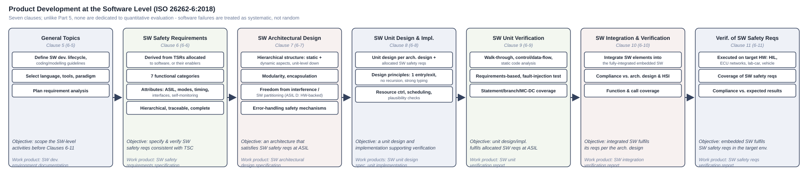

## 6-5 General Topics for the Product Development at the Software Level (Clause 5)

Clause 5 has no dedicated inputs or work product of its own - it exists to frame Clauses 6-11, matching the
pattern of Part 4/5's own Clause 5. Its activities:

* defining the phases of the software development cycle;
* preparing coding guidelines, and planning the modelling/design approach;
* planning the software development paradigm and requirement-analysis approach; and
* documenting the resulting software development environment - the one work product this clause feeds
  forward into every later clause.

**Selection criteria for a suitable programming or modelling language**:

* an unambiguous and comprehensible definition of syntax and semantics, or a restriction/configuration of
  the development environment that achieves the same effect;
* suitability for specifying and managing safety requirements per ISO 26262-8:2018, Clause 6, if modelling
  is used for requirements engineering;
* support for modularity, abstraction and encapsulation;
* support for structured constructs; and
* strong typing.

  Assembly language can be used where a high-level language is unsuitable - low-level software with
  hardware interfaces, interrupt handlers, time-critical algorithms - but this can require tailoring the
  development phases specifically for it. Existing coding/modelling guidelines can be reused or adapted
  rather than written from scratch for a given item.

**Topics to be addressed by coding and modelling guidelines** (ASIL-weighted; `o` no recommendation,
`+` recommended, `++` highly recommended):

| Topic | ASIL A | ASIL B | ASIL C | ASIL D |
|---|---|---|---|---|
| Enforcement of low complexity | ++ | ++ | ++ | ++ |
| Use of language subsets | ++ | ++ | ++ | ++ |
| Enforcement of strong typing | ++ | ++ | ++ | ++ |
| Use of defensive implementation techniques | + | + | ++ | ++ |
| Use of well-trusted design principles | + | + | ++ | ++ |
| Use of unambiguous graphical representation | + | ++ | ++ | ++ |
| Use of style guides | + | ++ | ++ | ++ |
| Use of naming conventions | ++ | ++ | ++ | ++ |
| Concurrency aspects | + | + | + | + |

* *Language subsets* exclude ambiguously-defined constructs (interpreted differently by different
  modellers/programmers/code generators/compilers), constructs that experience shows easily lead to
  mistakes (e.g. assignment inside a condition, identical naming of local and global variables), and
  constructs that could result in unhandled run-time errors.
* *Defensive implementation* examples: verify a divisor before a division (non-zero, or within a specific
  range); check an identifier passed by parameter to confirm the calling function is the intended caller;
  use the `default` case in a switch statement to detect an error.
* *Concurrency aspects* are not limited to multi-core/multi-processor runtimes - concurrency of processes or
  tasks on a single core is in scope too.

## 6-6 Specification of Software Safety Requirements (Clause 6)

**Purpose**: derive the software safety requirements from the technical safety requirements allocated to
software, and verify their consistency with the technical safety concept.

**Inputs**:
  - prerequisites: technical safety requirements specification, technical safety concept, system
    architectural design specification, HSI specification, documentation of the software development
    environment (6-5);
  - further supporting information: hardware design specification, specification of non-safety-related
    functions, specification of other properties of the software.

**Derivation** - software safety requirements are either derived directly from the TSRs allocated to
software, or are requirements for software functions/properties whose non-fulfilment could violate those
TSRs. Seven recurring functional categories:
  1. functions enabling the safe execution of a nominal function;
  2. functions enabling the system to achieve or maintain a safe state, or a degraded state;
  3. functions related to detecting, indicating and mitigating faults of safety-related hardware elements;
  4. self-test or monitoring functions detecting, indicating and mitigating failures of the operating
     system, basic software or the application software itself;
  5. functions related to on-board and off-board tests during production, operation, service and
     decommissioning;
  6. functions allowing safe modification of the software during production and service (flashing,
     parameter programming); and
  7. functions related to performance- or time-critical operations.

**What the specification must reflect**: the specification/management approach for safety requirements
itself, the specified system and hardware configurations, the HSI specification, the relevant hardware
design requirements, timing constraints, external interfaces, and every operating mode (and transition
between operating modes) of the vehicle, system or hardware that affects the software.

**Attributes each software safety requirement should carry**: its ASIL; the system operating modes it
applies to (unless already covered by the system specification); self-monitoring behaviour - periodic
self-tests detecting/handling software and hardware faults; timing response and resource needs;
interfaces; and an explicit assignment of which functions:
  - are safety-related;
  - are used to achieve/maintain a safe state;
  - detect and report software errors or hardware failures;
  - perform online tests;
  - perform offline tests; and
  - safely modify the software (update, parameter programming).

**Overall properties the specification must demonstrate**: hierarchical structure; traceability, both
vertical (down to system safety requirements - every software safety requirement must trace back to a
system safety requirement) and horizontal; completeness; external consistency; and internal consistency.

**Verification** - provides evidence the requirements fulfil the properties above:
  - *review aspects*: a checklist covering precision, clarity, feasibility, consistency, understandability
    and verifiability; an adequate notation chosen for the ASIL and complexity involved;
  - *process aspects*: test cases specified by a second party; a joint review of those test cases by the
    review engineer and the test specifier; and the reviewers' role/experience taken into account.

  **Verification methods**:

  | Method | ASIL A | ASIL B | ASIL C | ASIL D |
  |---|---|---|---|---|
  | Informal verification by walkthrough | ++ | + | o | o |
  | Verification by inspection | + | ++ | ++ | ++ |
  | Semi-formal verification | + | + | ++ | ++ |
  | Formal verification | o | + | + | + |

  These methods demonstrate that the software safety requirements are compliant with the technical safety
  requirements and system design, and consistent with the relevant parts of the hardware safety
  requirements.

## 6-7 Software Architectural Design (Clause 7)

**Purpose**:

* develop a software architectural design that satisfies the software safety requirements and the other
  software requirements;
* verify that the design is suitable to satisfy the software safety requirements at their required ASIL;
  and
* support the implementation and verification of the software.

**What the architecture is**: it represents the software architectural elements and their interactions in a
hierarchical structure, describing both static aspects (interfaces between components) and dynamic aspects
(process sequences, timing behaviour). It handles safety-related and non-safety-related requirements within
one development process, and provides the means to manage the complexity of the detailed design and
implementation at the required ASIL.

**Inputs**:
  - prerequisites: documentation of the software development environment (6-5), the refined HSI
    specification, the software safety requirements specification (6-6);
  - further supporting information: the technical safety concept, system architectural design
    specification, qualified software components, specification of non-safety-related functions/properties
    and other software requirements.
**Factors to consider while developing the architecture**: verifiability (implying bi-directional
traceability), suitability for configurable software, feasibility of unit-level design/implementation,
testability during software integration testing, and maintainability.

**Basic principles the architecture must exhibit** (ASIL-weighted):

  | Principle | ASIL A | ASIL B | ASIL C | ASIL D |
  |---|---|---|---|---|
  | Appropriate hierarchical structure of the software components | ++ | ++ | ++ | ++ |
  | Restricted size and complexity of software components | ++ | ++ | ++ | ++ |
  | Restricted size of interfaces | + | + | + | ++ |
  | Strong cohesion within each software component | + | ++ | ++ | ++ |
  | Loose coupling between software components | + | ++ | ++ | ++ |
  | Appropriate scheduling properties | ++ | ++ | ++ | ++ |
  | Restricted use of interrupts | + | + | + | ++ |
  | Appropriate spatial isolation of the software components | + | + | + | ++ |
  | Appropriate management of shared resources | ++ | ++ | ++ | ++ |

  Cohesion/coupling map to separation of concerns - the ability to identify, encapsulate and manipulate the
  parts of the software relevant to one concept, goal, task or purpose; loose coupling in particular
  addresses the management of dependencies between components. Restricted interrupt use means minimizing
  their number, or giving them a clear priority, to achieve deterministic behaviour. Shared-resource
  management applies to shared hardware *and* software resources in the case of coexistence, and can be
  implemented in software or hardware: it must prevent conflicting access and detect/handle conflicts that
  do occur.

**Modularity and encapsulation** - the underlying idea is separating functionality from realization:
  - a component has a defined interface and a defined behaviour;
  - it is realized internally by a structure and algorithm using local data, hidden behind that interface -
    internal structure, internal data and algorithms are all hidden; and
  - the interface is a contract, so the realization can be exchanged without affecting other components -
    optimization becomes easy and changes stay local.

**Notations for the software architectural design**:

  | Notation | ASIL A | ASIL B | ASIL C | ASIL D |
  |---|---|---|---|---|
  | Natural language | ++ | ++ | ++ | ++ |
  | Informal notations | ++ | ++ | + | + |
  | Semi-formal notations | + | + | ++ | ++ |
  | Formal notations | + | + | + | + |

  Natural language complements a notation where a topic is more readily expressed in words, or to explain
  the rationale behind a decision captured in the notation. Semi-formal notations include pseudocode or
  modelling with UML, SysML, Simulink or Stateflow.

**Scheduling properties** that can be defined:    --  - static vs. dynamic scheduler; 
  - pre-emptive vs non-pre-emptive scheduling; 
  - per-task priority, 
  - execution frequency
  - instant of first execution.

  Hardware interrupts can't generally be avoided in an embedded system, but software-interrupt use should be
  minimized, and prioritized if more than one is in use.

**Design down to indivisible software components** - the architecture is developed down to that level and
must describe:
  - *static design aspects*: the software structure and its hierarchical levels; data types and their
    characteristics; external interfaces of the software components; external interfaces of the embedded
    software; global variables; and constraints, including the scope of the architecture and external
    dependencies.
  - *dynamic design aspects*: the functional chain of events and behaviour; the logical sequence of data
    processing; control flow and concurrency of processes; data flow through interfaces and global
    variables; and temporal constraints.

**ASIL treatment of mixed-ASIL software** - if the embedded software implements components of different
ASILs, or safety-related and non-safety-related components together, all of it is treated at the highest
ASIL present, unless the components meet the coexistence criteria of ISO 26262-9:2018, Clause 6 by
demonstrating **freedom from interference**.

**Software partitioning**, where used to implement freedom from interference, must ensure:
  - shared resources are used such that freedom from interference of the partitions is preserved (tasks
    *within* one partition are not required to be free from interference among each other);
  - one partition cannot change the code or data of another partition, nor command another partition's
    non-shared resources; and
  - the service one partition receives from a shared resource cannot be affected by another partition -
    covering the resource's performance as well as the rate, latency, jitter and duration of scheduled
    access to it.

  Partitioning is supported by dedicated hardware features (or equivalent means) at ASIL D. The software
  element that implements the partitioning itself is developed to the highest ASIL among the partitions it
  separates - typically supplied or supported by the operating system. Correct partitioning is verified
  during software integration and testing (6-10), and safety-oriented analysis is additionally carried out
  at the architectural level itself.

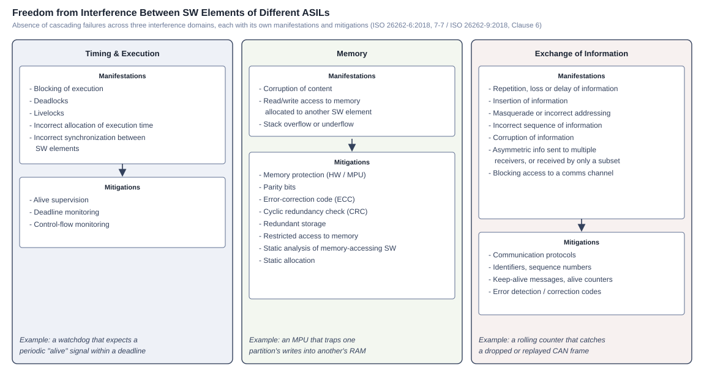

**Safety mechanisms for error handling** can include:
  - deactivation, to achieve/maintain a safe state;
  - static recovery mechanisms (recovery blocks, backward recovery, forward recovery, recovery through
    repetition);
  - graceful degradation - prioritizing functions to minimize the adverse effect of a potential failure;
  - homogeneous redundancy - primarily controls transient/random hardware faults affecting similar software
    (e.g. temporally redundant execution);
  - diverse redundancy - dissimilar software in parallel paths, primarily controlling systematic software
    faults;
  - correcting codes for data; and
  - access-permission management (software or hardware) granting/denying access to safety-related shared
    resources.

**Estimation of required resources** - an upper-bound estimate of CPU time, storage (RAM for stack/heap,
ROM for program and non-volatile data), and communication resources.

**Methods for verification of the software architectural design**:

  | Method | ASIL A | ASIL B | ASIL C | ASIL D |
  |---|---|---|---|---|
  | Walk-through of the design | ++ | + | o | o |
  | Inspection of the design | + | ++ | ++ | ++ |
  | Simulation of dynamic behaviour of the design | + | + | + | ++ |
  | Prototype generation | o | o | + | ++ |
  | Formal verification | o | o | + | + |
  | Control flow analysis | + | + | ++ | ++ |
  | Data flow analysis | + | + | ++ | ++ |
  | Scheduling analysis | + | + | ++ | ++ |

  For model-based development, walk-through/inspection can also be applied to the model itself; control- and
  data-flow analysis can be limited to safety-related components and their interfaces.

## 6-8 Software Unit Design and Implementation (Clause 8)

**Purpose**:

* develop a software unit design, in accordance with the architectural design, the design criteria and the
  allocated software requirements, that supports implementation and verification of the unit; and
* implement the software units as specified.

**Inputs feeding the unit design/implementation**: the software architectural design, the software safety
requirements, the target hardware, the coding guidelines, and the HSI - producing the source code
specification (the unit design) and, from it, the source code itself. Unit design is verified via static
walk-through, control-flow analysis, data-flow analysis and inspection before implementation proceeds.

**Notations for software unit design** carry the same ASIL weighting as the architectural-design notations
table in 6-7 (natural language / informal / semi-formal / formal).

**Design principles for software unit design and implementation** (ASIL-weighted):

  | Principle | ASIL A | ASIL B | ASIL C | ASIL D |
  |---|---|---|---|---|
  | One entry and one exit point in subprograms and functions | ++ | ++ | ++ | ++ |
  | No dynamic objects or variables, or else online test during their creation | + | ++ | ++ | ++ |
  | Initialization of variables | ++ | ++ | ++ | ++ |
  | No multiple use of variable names | ++ | ++ | ++ | ++ |
  | Avoid global variables, or else justify their usage | + | + | ++ | ++ |
  | Restricted use of pointers | + | ++ | ++ | ++ |
  | No implicit type conversions | + | ++ | ++ | ++ |
  | No hidden data flow or control flow | + | ++ | ++ | ++ |
  | No unconditional jumps | ++ | ++ | ++ | ++ |
  | No recursions | + | + | ++ | ++ |

  Principles that assume textual code (entry/exit points, dynamic objects, multiple variable-name use,
  global variables, pointers, unconditional jumps) may not apply to graphical modelling notations used in
  model-based development.

**What these principles achieve**: 
  * correct order of execution of subprograms/functions per the architectural design;
  * consistency of interfaces between units; 
  * correctness of data flow and control flow within and between units; 
  * simplicity; 
  * readability and comprehensibility; 
  * robustness (methods preventing implausible values, execution-time errors, division by zero, and data-/control-flow errors); 
  * suitability for modification; and verifiability.

**Safety-compliant construction practices**:
  - *Resource control* - shared resources (memory, I/O bus) are commonly contended for by multiple
    processes: use semaphores to protect exclusive access, guard against priority inversion, avoid deadlock
    (and provide prevention/recovery for resource conflicts), detect resource starvation and take corrective
    action, and rely on the microcontroller's memory protection to stop the OS/scheduler or variables being
    overwritten.
  - *Scheduling* - prefer static over dynamic scheduling; the system must not violate safety requirements
    under peak load, and must not resort to disabling or delaying safety checks (including hardware test
    routines such as RAM/ROM checks) to cope with load. The scheduler/OS should be deterministic; if it
    isn't, a monitor must ensure every process completes within its allotted time. Priority-driven
    schedulers are only used for safety-critical tasks if the hardware and OS provide timing protection.
  - *Feedback/feed-forward loops from hardware* - design to avoid a runaway condition from a short-to-ground,
    short-to-battery or other hardware failure, and make such failures isolable: avoid representing sensor
    inputs as all-0s or all-1s (reserve those for fault indication instead of valid data), monitor for a
    value that stays unchanged over an abnormally long period, and avoid branching control flow on an
    all-0/all-1 value.
  - *Inter-CPU communication* - dual-microcontroller safety functions typically share load, run one
    supervisory/degraded-mode micro against the other, or run in lock-step; whichever pattern is used, the
    inter-microcontroller interface needs monitoring (CRC, parity) to detect errors and act on a
    safety-critical failure in time.
  - *Plausibility checks* - limit and reasonableness checks (time limits, dependencies) performed on every
    interface before a safety-critical function executes; domain-specific correlation checks are useful too
    (e.g. vehicle speed vs. engine speed vs. engine status). No safety-critical function executes without
    verifying its input data (analogue or digital) - via expected-range checks, checksums or rolling
    counters.

## 6-9 Software Unit Verification (Clause 9)

**Purpose**:

* provide evidence that the unit design satisfies its allocated software requirements and is suitable for
  implementation;
* verify that safety measures resulting from safety-oriented analyses are correctly implemented;
* provide evidence that the implemented unit complies with its design and fulfils its allocated requirements
  at the required ASIL; and
* provide sufficient evidence that the unit contains neither undesired functionality nor undesired
  properties regarding functional safety.

**Methods for software unit verification** (ASIL-weighted):

| Method | ASIL A | ASIL B | ASIL C | ASIL D |
|---|---|---|---|---|
| Walk-through | ++ | + | o | o |
| Pair-programming | + | + | + | + |
| Inspection | + | ++ | ++ | ++ |
| Semi-formal verification | + | + | ++ | ++ |
| Formal verification | o | o | + | + |
| Control flow analysis | + | + | ++ | ++ |
| Data flow analysis | + | + | ++ | ++ |
| Static code analysis | ++ | ++ | ++ | ++ |
| Static analyses based on abstract interpretation | + | + | + | + |
| Requirements-based test | ++ | ++ | ++ | ++ |
| Interface test | ++ | ++ | ++ | ++ |
| Fault injection test | + | + | + | ++ |
| Resource usage evaluation | + | + | + | ++ |
| Back-to-back comparison test between model and code, if applicable | + | + | ++ | ++ |

**For model-based development**:
  * *the walk-through/pair-programming/inspection methods* can be applied at model level where the confidence in the code generator justifies it. 
  * *Static analyses* based on abstract interpretation extend the compiler's parse tree with semantic information checkable against defined rules
(data-type problems, uninitialized variables), control-flow-graph generation and data-flow analysis (race
conditions, deadlocks, pointer misuse), or even meta-compilation and abstract code/model interpretation.
  * *Fault injection* at unit level means modifying the unit under test - introducing arbitrary faults, e.g. by corrupting variable values, mutating code, or corrupting CPU register values - to test its safety
mechanisms.

**Methods for deriving test cases for unit testing**:

| Method | ASIL A | ASIL B | ASIL C | ASIL D |
|---|---|---|---|---|
| Analysis of requirements | ++ | ++ | ++ | ++ |
| Generation and analysis of equivalence classes | + | ++ | ++ | ++ |
| Analysis of boundary values | + | ++ | ++ | ++ |
| Error guessing based on knowledge or experience | + | + | + | + |

**Structural coverage metrics at the software unit level** - to evaluate test-case completeness and
demonstrate the absence of unintended functionality, requirements coverage is determined and structural
coverage measured (via appropriate tools) against:

| Metric | ASIL A | ASIL B | ASIL C | ASIL D |
|---|---|---|---|---|
| Statement coverage | ++ | ++ | + | + |
| Branch coverage | + | ++ | ++ | ++ |
| MC/DC (Modified Condition/Decision Coverage) | + | + | + | ++ |

Analysis of structural coverage can reveal shortcomings in the requirements-based test cases, inadequacies
in the requirements themselves, dead code, deactivated code, and unintended functionality.

**Test environments** - unit testing can be executed as model-in-the-loop, software-in-the-loop, process-
in-the-loop or hardware-in-the-loop tests. For model-based development, unit testing can be carried out at
model level first, followed by back-to-back tests between the model and the generated code, confirming the
generated code's behaviour is equivalent to the model's with respect to the test objectives.

## 6-10 Software Integration and Verification (Clause 10)

**Purpose**:

* define the integration steps and integrate the software elements until the embedded software is fully
  integrated;
* verify that safety measures resulting from safety analyses at the architectural level are properly
  implemented;
* provide evidence that the integrated units/components fulfil their requirements per the software
  architectural design; and
* provide sufficient evidence that the integrated software contains neither undesired functionality nor
  undesired properties regarding functional safety.

**What software integration testing demonstrates**: compliance with the software architectural design;
compliance with the HSI specification; correct implementation of the functionality; robustness (absence of
inaccessible software, effective error detection and handling); and sufficiency of resources to support
the functionality.

**Integration-testing considerations**:
  - the embedded software included in a production release must not contain unintended/unspecified
    functionality; if such functions can be reliably deactivated, deactivation is an acceptable means of
    compliance, otherwise removing the code is the required change;
  - the test environment must be suitable for the integration-testing objectives given the target
    environment - if testing isn't carried out in the target environment itself, the differences between
    the test and target environments (e.g. different bit widths of data/address words between processors)
    must be analysed to specify additional tests for later phases; and
  - the appropriate test environment (target processor, processor emulator, or a development system) is
    chosen per integration step and per the scope/hierarchical level of the tests.

**Methods for software integration verification**:
  1. requirements-based test;
  2. interface test;
  3. fault injection test - injecting arbitrary faults to test safety mechanisms, e.g. by corrupting
     software or hardware components;
  4. resource usage evaluation - average/maximum processor performance, minimum/maximum execution times,
     storage usage (RAM for stack/heap, ROM for program/data) and communication-link bandwidth, with
     sufficient tolerance against the requirements the hardware architectural design influences; some
     aspects are only properly evaluable on the target hardware or an emulator that supports resource-usage
     tests;
  5. back-to-back test between model and code, if applicable;
  6. verification of control flow and data flow;
  7. static code analysis; and
  8. static analyses based on abstract interpretation.

**Methods for deriving software integration test cases / structural coverage at the architectural level** -
evaluating test-case completeness and the absence of unintended functionality:
  - **function coverage** - at least one execution of every software function, evidenced by an appropriate
    software integration strategy; and
  - **call coverage** - at least one execution of every software function call.

## 6-11 Verification of Software Safety Requirements (Clause 11)

**Purpose**: verify that the embedded software fulfils its safety-related requirements when executed in the
target environment, and that it contains neither undesired functionality nor undesired properties regarding
functional safety.

* Verification of the software safety requirements is planned, specified and executed against the embedded
  software running in suitable test environments:
  - hardware-in-the-loop;
  - ECU network environments - test benches partially or fully integrating a vehicle's electrical systems,
    "lab-car" or "mule" vehicles, and "rest-of-the-bus" simulations; and
  - vehicles.
* Verification is executed on the target hardware. Results are evaluated against:
  - compliance with the expected results; and
  - coverage of the software safety requirements.

## Model-Based Development Considerations

Model-based development (MBD) cuts across Clauses 6-11 rather than sitting inside one of them, and its
potential to coalesce phases that are otherwise kept separate (safety requirements, architectural design,
unit design/implementation, model-based integration with code generation) brings both benefits - continuity,
information sharing across the lifecycle, consistency - and its own risk of introducing systematic faults if
applied carelessly.

**Specification of software safety requirements** - a model can capture required states/transitions (e.g.
a state machine) more intuitively, unambiguously and completely than an equivalent textual specification,
satisfying the semi-formal/formal notation requirements of ISO 26262-8:2018, Clause 6 - one such model
representing more than one atomic textual requirement is acceptable if completeness, verifiability and
internal consistency are better achieved and maintained that way. The risk: a modelling approach might not
be able to express every kind of requirement (e.g. software robustness against missing/erroneous input),
so ISO 26262-8:2018, Clause 6 calls for an appropriate combination of textual requirements and other
notations rather than relying on the model alone.

**Software architectural design** - models can express static aspects (components, interfaces, data
flows, component attributes) and dynamic aspects (functional chain of events, scheduling, message
passing), satisfying the semi-formal/formal notation properties from 6-7. Risk: one modelling approach may
not express every needed aspect (e.g. a model targeting application-software functions often omits basic
software/OS elements of the overall architecture), and the model may not be understandable without
supporting textual explanation for other collaborating parties.

**Design and implementation of software units** - executable code can be generated directly from the
model. MBD enables automated consistency checks (data typing, correct definition before use) and
verification by formal methods, simulation, static analysis, or model-/software-in-the-loop testing, and
can lower the risk of coding errors versus manual coding. Risks: design aspects the modelling notation
can't express may go undocumented and untested if all unit tests derive only from that "incomplete" model
(even back-to-back testing won't catch this); safety-related code properties such as robustness depend on
the combination of model properties *and* code-generator properties, not the model alone (example: if a
generator emits a division "as is," division-by-zero avoidance needs checking in the model, but if the
generator itself handles division-by-zero robustly, the model-level check may be moot); and auto-generated
code's resource usage (execution time, memory) can differ from hand-written code, with fewer optimization
options and a harder verifiability argument for source-code equivalence (tool/style guidelines such as
MAAB can help).

**Design, implementation and integration of software components via automated code generation from
component-level models** - a stronger coalescence of the SW development phases again, needing a careful
evaluation of benefit vs. risk and, where used, dedicated safety measures such as a separate verification
model for deriving additional test cases.

**Verification (static and/or dynamic)** - a "verification model," distinct from the design model, can
serve as the basis for back-to-back testing and can enable earlier/more efficient fault detection, more
efficient test-case generation, highly automated testing, or formal verification techniques.

## Work Products (Clauses 5-11)

* Documentation of the software development environment
* Software safety requirements specification
* Hardware-software interface specification (refined)
* Software architectural design specification
* Safety analysis report
* Dependent failures analysis report
* Software unit design specification
* Software unit implementation (source code)
* Software verification specification and report (unit, integration and embedded-software levels, each
  refined as development progresses)
* Embedded software
